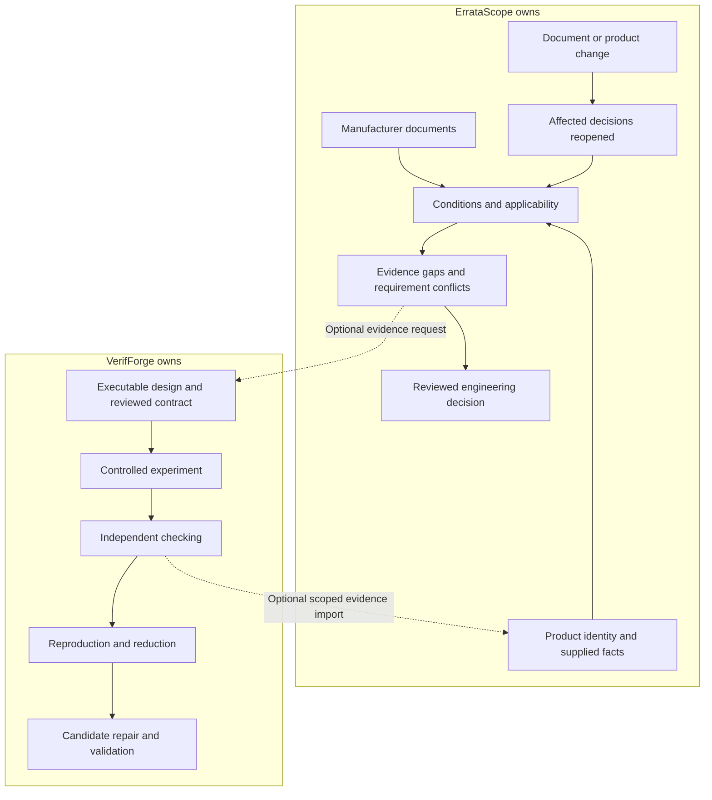
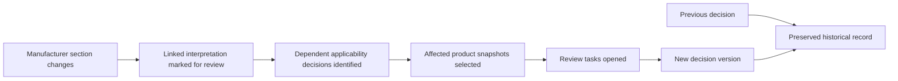
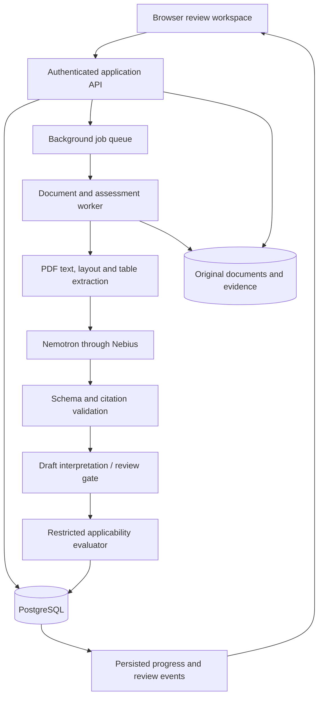
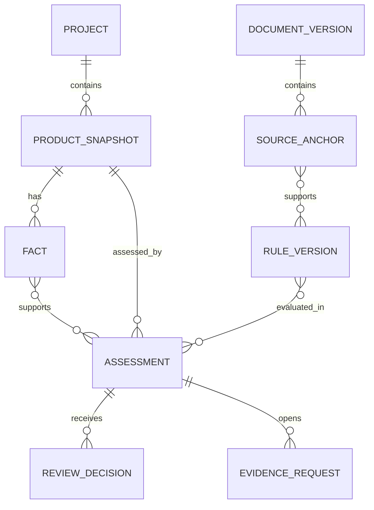

# ErrataScope Project Gameplan

Execution update, 29 October 2026: [credits restored](docs/execution/decisions/2026-10-29-credits-restored.md). Current dispatch is [W01 live v2](docs/execution/prompts/W01-LIVE-COMPLETION-V2.md); W02 binding is prepared and follows live acceptance. Earlier temporary deferral is superseded; UI approval remains required.

Compiled on 28 October 2026 from the complete supplied plan. Research dates, proposed capabilities, alternatives, limitations, and citations are preserved. This document records the project proposal; it does not indicate that the application has been implemented or that every alternative has been selected.

- [Original supplied text, preserved verbatim](references/original-plan.txt)
- [Interactive evidence explorer](visuals/erratascope-evidence-explorer.html)
- [Editable illustration fragment](visuals/erratascope-evidence-explorer.fragment.html)

The four architecture and relationship diagrams below use Mermaid. Open this document in a Markdown viewer that supports Mermaid to render them.

## Contents

- [1. The separation needs to be a product rule, rather than a difference in branding or model provider.](#section-1)
- [2. Several features from my earlier ErrataScope proposal should now be removed or reassigned.](#section-2)
- [3. The strongest ErrataScope concept is “living engineering decisions,” rather than a one-time errata summary.](#section-3)
- [4. There are current, concrete problems that support this direction.](#section-4)
- [5. The project needs a defensible distinction from existing tools as well as from VerifForge.](#section-5)
- [6. The end-to-end experience should follow an engineer’s decision process.](#section-6)
- [7. The system must distinguish applicability, evidence quality, review status, and freshness.](#section-7)
- [8. The technical depth belongs in six domain components.](#section-8)
- [9. Requirement-conflict analysis can remain sophisticated without crossing into execution.](#section-9)
- [10. The architecture should be a modular application with separate document workers.](#section-10)
- [11. The database should represent versioned evidence, rather than storing everything in a chat transcript.](#section-11)
- [12. The API should expose review operations, not generic agent execution.](#section-12)
- [13. The frontend should make evidence inspection faster than reading the whole document again.](#section-13)
- [14. There are several credible stack choices; the best choice depends on the product shape.](#section-14)
- [15. Nemotron should perform essential interpretation work, while the application controls decisions.](#section-15)
- [16. The security and reliability requirements follow directly from the evidence workflow.](#section-16)
- [17. The use-case range is broad within this specific domain.](#section-17)
- [18. Evaluation should test the dangerous mistakes directly.](#section-18)
- [19. The hackathon deliverable should demonstrate the complete decision lifecycle.](#section-19)
- [20. Longer-term expansion can remain ambitious without consuming VerifForge’s roadmap.](#section-20)

---

**Yes—ErrataScope should be designed around VerifForge’s entire planned direction, including the work already underway.** My earlier comparison put too much weight on VerifForge’s current implementation. That was the wrong basis for separating your projects.

I have now reviewed the full [VerifForge implementation gameplan](https://github.com/desanv01/VerifForge/blob/main/docs/project/IMPLEMENTATION_GAMEPLAN.md), including its planned formal verification, software investigation, CAD automation, proprietary-tool investigation, and hardware-in-the-loop extensions.

**My revised recommendation is to build ErrataScope as a manufacturer-advisory applicability and engineering-review system.** Its central job would be:

> Turn changing manufacturer documentation into traceable, product-specific engineering decisions—and identify exactly which evidence or decisions need attention.

That gives it considerable technical depth while preserving VerifForge’s investigation, execution, and repair territory.

The research below is current to **28 October 2026**. Product architecture, proposed features, and evaluation targets are recommendations, not implemented or measured capabilities.

---

<a id="section-1"></a>

## 1. The separation needs to be a product rule, rather than a difference in branding or model provider.

VerifForge’s scope should remain broad:

> Investigate engineering or software behavior through controlled execution, independent checks, reproducible evidence, and validated changes.

ErrataScope’s scope should be specific:

> Establish how manufacturer notices apply to identified products, connect the conclusions to evidence, manage unresolved requirements, and reassess decisions when the evidence changes.

| Dimension | VerifForge—including its planned expansion | Revised ErrataScope |
|---|---|---|
| Fundamental question | “What does this implementation do, why does it fail, and does this change resolve it?” | “Which manufacturer limitations affect this product, what supports that conclusion, and what needs review?” |
| Starting material | Executable designs, programs, tool environments, behavioral contracts | Errata, advisories, technical clarifications, product identities, configuration facts |
| Primary operation | Run and investigate | Interpret, match, trace, compare, review |
| Main engine | Experiments, adapters, checkers, reduction, repair validation | Document processing, applicability rules, evidence dependencies, semantic change analysis |
| Main output | Reproducible finding or scoped verification result | Applicability assessment and engineering decision record |
| Uncertainty resolution | Execute a suitable experiment | Identify missing evidence and route it to an engineer or external system |
| Change handling | Rerun investigations and validate repairs | Identify which prior decisions have become stale |
| Primary interface | Campaigns, traces, failures, comparisons, repair candidates | Source passages, affected products, condition evidence, review decisions |
| Product completion | An investigation reaches a checked outcome | A review reaches a documented disposition, with remaining obligations explicit |

**Some shared infrastructure is normal.** Both can use PostgreSQL, Python, immutable artifacts, typed schemas, and AI. Those technologies do not make the products the same.

The meaningful boundary is what each product **does for its user**.



The dotted connection is an optional future interchange. **ErrataScope must work independently of VerifForge.**

---

<a id="section-2"></a>

## 2. Several features from my earlier ErrataScope proposal should now be removed or reassigned.

This is the most important correction to the previous gameplan.

| Earlier suggestion | Revised decision | Reason |
|---|---|---|
| Bounded simulation of reset/power sequences | VerifForge territory | It creates an executable behavioral investigation engine |
| Generate and execute tests for a workaround | VerifForge territory | It is experiment planning and validation |
| Produce behavioral counterexample traces | VerifForge territory | It overlaps with checking and reproduction |
| Generate firmware patches and validate them | VerifForge territory | Repair is already part of VerifForge’s direction |
| Build a general firmware or ELF verification engine | Exclude from ErrataScope | It moves toward executable-artifact assurance |
| Interpret vendor conditions with citations | Keep in ErrataScope | This is its central document-evidence problem |
| Evaluate those conditions against supplied facts | Keep, within a restricted rule vocabulary | This determines documentary applicability |
| Identify contradictory documented requirements | Keep | This is a review finding under stated facts |
| Request missing revision/configuration/measurement evidence | Keep | It helps engineers resolve uncertainty |
| Import an externally produced test result | Keep as evidence | Importing evidence does not mean owning its execution |
| Track changes and reopen affected assessments | Make this a central feature | It provides lasting value beyond the initial analysis |

There is a subtle but important distinction between these two outputs:

- **ErrataScope:** “These reviewed requirements conflict under the supplied facts.”
- **VerifForge:** “This executed sequence demonstrates the failure under the recorded environment.”

ErrataScope may identify a reason to investigate. It should not claim it has performed that investigation.

**We cannot guarantee that two ambitious products will never share any concept. We can enforce a clear ownership boundary.** I would put the boundary in both project briefs and apply this feature-routing test:

> Does the feature execute, reproduce, diagnose, or validate implementation behavior? It belongs to VerifForge.  
> Does it establish documentary applicability, evidence provenance, or review impact? It belongs to ErrataScope.

Separate repositories, demonstrations, datasets, domain models, and backlogs would make that separation concrete.

---

<a id="section-3"></a>

## 3. The strongest ErrataScope concept is “living engineering decisions,” rather than a one-time errata summary.

Consider what an engineer actually needs to know:

1. Which exact component and silicon revision do we have?
2. Which version of the manufacturer’s documentation was reviewed?
3. Which limitations apply to our configuration?
4. Which conclusions rely on assumptions?
5. Does a documented workaround introduce another requirement we cannot satisfy?
6. What evidence would resolve the uncertainty?
7. Who reviewed the conclusion?
8. What changed since that review?
9. Which products or releases need another review?

A PDF chatbot can help with the first reading. It does not automatically maintain this chain over the life of a product.

**The valuable object is a decision with dependencies.**

For example:

> Assessment A was accepted for board revision B, firmware build C, and silicon revision D, using document revision E and evidence F.

When any relevant dependency changes, ErrataScope should explain which part of the assessment needs attention.

This is useful to:

- Individual embedded developers.
- Hardware startups.
- Firmware teams.
- Component and sustaining engineers.
- Engineering managers responsible for several product variants.
- Manufacturers maintaining products for many years.
- Quality teams assembling engineering review records.

The first users should be **embedded engineering teams**, not every consumer or corporation. Ordinary people benefit indirectly when the devices they rely on are maintained more reliably.

---

<a id="section-4"></a>

## 4. There are current, concrete problems that support this direction.

A particularly relevant ST discussion began on **6 October 2026**, with an expert response relayed by an ST moderator on **26 October**. A developer using an STM32N657 revision B described a reset workaround conflicting with the board’s power-hold arrangement. The response clarified conditions around completing the workaround before an external NRST event; it did not establish that the developer’s board was safe under those conditions. This is exactly the gap between a manufacturer instruction and a product-specific engineering decision. [ST discussion](https://community.st.com/stm32-mcus-products-25/stm32n657-revision-b-nrst-workaround-without-an-initial-software-reset-168780)

A second example is NXP’s **1 October 2026** notice updating i.MX 8M Mini errata from revision 1.2 to 1.3. It lists added errata and affected part numbers. For an existing product, receiving the notice is only the beginning: someone must determine whether the newly documented conditions affect its configuration and reopen the appropriate reviews. [NXP change notice](https://www.nxp.com/pcn/202609010I)

These support two complementary demonstrations:

| Demonstration | What it proves about ErrataScope |
|---|---|
| A workaround creates an unresolved or conflicting requirement | The system connects document conditions to product evidence |
| A manufacturer publishes a revised notice | The system identifies which decisions need reassessment |

**Neither demonstration requires ErrataScope to become a simulator.**

---

<a id="section-5"></a>

## 5. The project needs a defensible distinction from existing tools as well as from VerifForge.

An important adjacent project is [Sentinel Forge](https://github.com/ashim373/Sentinel-Forge). Its documented focus is checking compiled firmware artifacts against silicon errata, including ELF files, effective configuration, linker information, and disassembly. It already describes typed conditions, three-valued logic, and evidence-bound verdicts.

Therefore, we should **not** claim that “AI converts errata into rules” or “unknown is a first-class outcome” is an entirely new invention.

Other adjacent areas include:

| Existing approach | Where ErrataScope should distinguish itself |
|---|---|
| Compiled-firmware errata gates | Own documentary applicability and review history across product variants |
| Datasheet and PCB assistants | Focus on manufacturer limitations and their changing applicability |
| PCN/BOM management systems | Add technical condition interpretation and evidence-dependent reassessment |
| Document chat/RAG | Produce structured, versioned decisions with explicit dependencies |

For example, [Z2Data’s PCN Manager](https://www.z2data.com/products/pcn-manager) already addresses product-change notification workflows. Matching notices to parts alone would not be a sufficient differentiator.

**The promising combination is: exact product identity + cited conditions + scoped evidence + change-driven review.** Whether that combination is commercially differentiated still needs user validation; it is a credible product hypothesis, not a proven market gap.

---

<a id="section-6"></a>

## 6. The end-to-end experience should follow an engineer’s decision process.

A typical workflow would be:

| Step | User action | System responsibility |
|---|---|---|
| 1. Identify | Select the product, board revision, components, and relevant build | Preserve exact identities and unresolved fields |
| 2. Collect | Upload or select manufacturer documents | Record provenance, versions, hashes, and retrieval dates |
| 3. Extract | Start analysis | Produce conditions, exceptions, and workaround requirements with citations |
| 4. Review | Inspect the extracted interpretation | Separate draft interpretations from accepted rules |
| 5. Assess | Supply relevant configuration facts | Evaluate applicability and expose missing evidence |
| 6. Investigate requirements | Inspect a flagged interaction | Show which documented requirements and facts produce the concern |
| 7. Decide | Accept, defer, reject, or assign an evidence request | Record the decision, scope, reviewer, and rationale |
| 8. Reassess | Import a new document or product snapshot | Identify affected assessments without erasing history |
| 9. Export | Generate a review packet | Include source references, evidence, decisions, and open obligations |

The primary action should be **“Assess applicability”** or **“Review changes.”** A chat box can be a secondary explanation feature.

---

<a id="section-7"></a>

## 7. The system must distinguish applicability, evidence quality, review status, and freshness.

One giant “safe/unsafe” status would collapse several different questions.

I would model at least these dimensions separately:

| Dimension | Example states |
|---|---|
| Applicability | Applicable, not applicable, unknown |
| Evidence condition | Supported, missing, contradictory, unsupported interpretation |
| Workaround documentation | Available, partial, none documented, unclear |
| Requirement review | No conflict identified, conflict under supplied facts, unresolved |
| Human disposition | Draft, accepted, deferred, rejected, superseded |
| Freshness | Current against selected baseline, reassessment required |

For example:

> **Applicable** does not imply **unmitigated**.  
> **Workaround documented** does not imply **implemented**.  
> **Implementation evidence supplied** does not imply **physically validated**.  
> **No conflict identified** does not imply **universally compatible**.

The following illustration uses an intentionally simplified rule, not a validated model of a real MCU. Change the supplied evidence to see how the decision changes.

[Open the interactive evidence explorer](visuals/erratascope-evidence-explorer.html).

An unknown revision should remain unknown. A changed source should reopen the relevant review. Neither should silently become a reassuring result.

---

<a id="section-8"></a>

## 8. The technical depth belongs in six domain components.

**A. Document identity and version management**

Each source needs more than a URL:

- Manufacturer and document identifier.
- Revision and publication date.
- Retrieval timestamp.
- Original file hash.
- Supersession relationships.
- Source type: formal errata, application note, technical clarification, forum response.
- Scope and authority.
- Original bytes and extracted representation.

A manufacturer forum clarification should retain its own identity and limitations. It should not silently replace an official errata entry because it is newer.

Similarly, a document section changing from “2.2.18” to “2.2.19” should not automatically create a different erratum. The system needs persistent identities and explicit matching decisions.

**B. Device and product identity**

The identity model should distinguish:

- Manufacturer part number.
- Family and variant.
- Package when relevant.
- Silicon revision.
- Board revision.
- Firmware/build identity.
- Operating profile.
- Evidence used to establish those values.

A BOM entry may establish the part family without establishing the silicon revision. A nearby part number is not sufficient evidence.

Fuzzy matching can propose candidates. It should not silently merge devices.

**C. Structured condition extraction**

Nemotron would draft a restricted representation of:

- Affected devices.
- Affected revisions.
- Trigger conditions.
- Exceptions.
- Documented consequences.
- Workaround requirements.
- Remaining restrictions.
- Source anchors.

Every condition should retain its supporting passage, including table headers and footnotes where those change the meaning.

**D. Evidence reconciliation**

A fact should carry its scope:

```text
Fact:
  subject: product snapshot / component instance
  property: relevant configuration or behavior
  value: typed value
  evidence kind: declared / extracted / measured / external report
  evidence reference: immutable artifact or source anchor
  scope: board, build, mode, environment
  review status: draft / accepted
```

Two facts may disagree because they refer to different builds, modes, or times. Resolve scope before deciding they contradict each other.

If genuinely conflicting evidence remains, preserve both and mark the assessment unresolved.

**E. Applicability and requirement evaluation**

Use a small, typed rule language with operations such as:

- Equality and membership.
- Numeric comparisons with explicit units.
- `all`, `any`, and `not`.
- Required evidence relationships.
- Explicit unknown propagation.

Do not execute model-generated Python or arbitrary expressions.

For conjunctions:

- One established false condition can rule out that conjunction.
- All established true conditions establish it.
- Otherwise the result remains unknown.

Contradictory evidence should be quarantined as a conflict requiring review, rather than resolved by whichever value arrived last.

**F. Dependency-driven reassessment**

Store which conclusions depend on which rules, facts, and source anchors.

A change then propagates through the relevant relationships:



This is the part that can make ErrataScope valuable after its first use.

---

<a id="section-9"></a>

## 9. Requirement-conflict analysis can remain sophisticated without crossing into execution.

Suppose the accepted inputs establish:

1. A relevant workaround requires action X.
2. The product requires property Y during the same operating phase.
3. Supplied evidence establishes that action X violates Y in that scope.

ErrataScope can identify that set of inconsistent requirements and evidence.

It should present:

- The applicable erratum.
- The documented action.
- The product requirement.
- The evidence establishing the incompatibility.
- The scope of that conclusion.
- Any unresolved assumptions.
- A request for external validation where needed.

It should not invent intermediate electrical or firmware behavior to complete the argument.

**This is a restricted consistency review of supplied facts.** A general temporal model checker, a simulated board, or an automatically generated execution trace would cross the boundary we have reserved for VerifForge.

A useful advanced feature is **missing-evidence prioritization**:

> Which unanswered question would resolve the greatest number of currently blocked assessments?

Start with a transparent heuristic: count dependent decisions, consider declared severity and evidence-acquisition effort, and explain the ordering. Do not present an arbitrary model score as a calibrated probability.

---

<a id="section-10"></a>

## 10. The architecture should be a modular application with separate document workers.



The backend modules would be:

| Module | Responsibility |
|---|---|
| Sources | Documents, provenance, source versions |
| Products | Components, variants, immutable product snapshots |
| Extraction | Parsing, model calls, draft interpretations |
| Rules | Supported condition vocabulary and rule versions |
| Evidence | Facts, citations, external artifacts, contradictions |
| Assessments | Applicability and requirement-review results |
| Changes | Source comparison and dependency invalidation |
| Reviews | Dispositions, ownership, rationale, open obligations |
| Exports | Human-readable and machine-readable review packets |

These can be Python packages within one service. They do not need separate microservices.

Long document processing belongs in a worker. FastAPI itself recommends larger background-processing tools when work needs execution outside the web process. [FastAPI guidance](https://fastapi.tiangolo.com/tutorial/background-tasks/)

The database should retain job state and assessment history. A queue entry disappearing must not make the application forget that work was requested.

---

<a id="section-11"></a>

## 11. The database should represent versioned evidence, rather than storing everything in a chat transcript.

A practical initial schema would include:

| Entity | Important contents |
|---|---|
| `Project` | Ownership, visibility, product family |
| `ProductSnapshot` | Immutable configuration identity |
| `ComponentInstance` | Part identity, revision, identity evidence |
| `DocumentVersion` | Document ID, revision, dates, hash, original artifact |
| `SourceAnchor` | Page, section, text span, bounding box, extraction version |
| `Erratum` | Stable manufacturer limitation identity |
| `RuleVersion` | Structured conditions, source anchors, review state |
| `Fact` | Typed value, subject, scope, provenance, review state |
| `EvidenceArtifact` | File hash, type, origin, access policy |
| `Assessment` | Snapshot, selected rule versions, evaluator version |
| `AssessmentItem` | Applicability, uncertainty, conflict, supporting dependencies |
| `ReviewDecision` | Reviewer, disposition, rationale, timestamp |
| `EvidenceRequest` | Missing fact, required scope, owner, resolution |
| `Dependency` | Which conclusion uses which input |
| `Job` / `Event` | Durable processing state and ordered progress |
| `ModelCall` | Model ID, prompt/schema versions, usage, validated output |



Use relational columns for identities, ownership, relationships, and lifecycle state. Use JSONB for versioned condition trees and structured extraction results.

PostgreSQL supports indexed JSONB, but JSONB does not preserve the original textual representation. **Original model responses and source files should therefore be retained separately where exact reproduction matters.** [PostgreSQL JSON documentation](https://www.postgresql.org/docs/current/datatype-json.html)

A graph-shaped domain does not automatically require a graph database. Foreign keys and dependency tables are sufficient for the initial scope.

---

<a id="section-12"></a>

## 12. The API should expose review operations, not generic agent execution.

A proposed surface:

```text
POST /projects
POST /projects/{id}/snapshots

POST /documents
POST /document-versions/{id}/extract
GET  /document-versions/{id}/anchors

POST /rule-versions/{id}/reviews
POST /snapshots/{id}/facts

POST /assessments
GET  /assessments/{id}
GET  /assessments/{id}/events
POST /assessments/{id}/decisions

POST /document-comparisons
GET  /document-comparisons/{id}/impact

POST /evidence-requests/{id}/responses
POST /assessments/{id}/exports
```

Important behavior:

- Long operations return a job identifier.
- Retried submissions use idempotency keys.
- Approved changes create new versions.
- Reads enforce project ownership.
- Assessment results retain the exact input versions.
- A stale result is not silently overwritten.
- Exports include unresolved evidence and assumptions.

An optional later MCP interface could expose operations such as `get_assessment`, `get_source_passage`, and `list_open_evidence_requests`. It should reuse the application’s permission checks and avoid introducing a second business-logic implementation.

---

<a id="section-13"></a>

## 13. The frontend should make evidence inspection faster than reading the whole document again.

I would build five focused views.

| View | What the user needs to do |
|---|---|
| Product snapshot | Establish which board, components, revisions, and configuration are being assessed |
| Assessment list | Find applicable, unresolved, and stale items |
| Evidence workspace | Inspect a condition beside its source passage and supporting project facts |
| Change review | See what changed and which decisions depend on it |
| Review packet | Read and export decisions, rationale, evidence, and open obligations |

The evidence workspace should place three things close together:

```text
SOURCE DOCUMENT           INTERPRETED CONDITION        PRODUCT EVIDENCE

Page and highlighted      Affected revisions           Exact component identity
passage                    Trigger conditions            Configuration facts
                           Exceptions                    Supporting artifacts
Table headers and         Workaround requirements       Contradictory evidence
footnotes                  Unresolved interpretation     Missing facts

                           REVIEW DECISION
                           Accept / revise / defer
```

That is a layout description, not a finished interface design.

Useful details include:

- Clicking a condition opens its exact source location.
- Every assessment displays its document and product baseline.
- Unknowns have an explanation and an actionable evidence request.
- A changed source shows the previous decision alongside the new review need.
- Search prioritizes exact part numbers and erratum identifiers.
- Review actions retain their rationale.
- Status does not depend on color alone.

Avoid unexplained confidence percentages. A reviewer needs to know **which fact is missing**, not that a model feels “87% confident.”

---

<a id="section-14"></a>

## 14. There are several credible stack choices; the best choice depends on the product shape.

An exhaustive list of every framework would be endless. The useful comparison is between the major viable approaches, including alternatives to my preferred stack.

For technical capabilities I used official documentation. Reddit supplies practitioner experiences and failure modes; it is not a reliable source of universal performance rankings.

**Frontend options**

| Option | Why it fits | Main tradeoff | My position |
|---|---|---|---|
| **React + Vite + TypeScript** | Good fit for a detailed browser workspace with a separate Python API | Routing, data fetching, and application conventions must be selected explicitly | **Preferred** |
| **Next.js** | Useful if public content, server rendering, and web-server features become important | Adds another server-side layer alongside the Python backend | Strong alternative |
| **Vue + Vite / Nuxt** | Component-oriented UI with either a separate API or fuller framework | Choice should follow familiarity and component needs | Equally credible if preferred |
| **SvelteKit** | Integrated web application framework with a different component model | Team familiarity and library integration need checking | Credible alternative |
| **Streamlit** | Fast Python-first review prototype and internal tool | Complex document interactions need careful state and component design | Good prototype path |
| **Gradio Blocks** | Convenient document-in/model-output demonstration | Less natural as the foundation for extensive engineering review workflows | Good model-evaluation interface |

React documents both the Vite route and its tradeoffs; Next.js explicitly supports SPAs, so the choice is not simply “dashboard means Next.js cannot work.” [React guidance](https://react.dev/learn/build-a-react-app-from-scratch), [Next.js SPA guidance](https://nextjs.org/docs/app/guides/single-page-applications)

[Vue](https://vuejs.org/guide/introduction.html), [SvelteKit](https://svelte.dev/docs/kit/introduction), [Streamlit](https://docs.streamlit.io/develop/concepts/architecture/architecture), and [Gradio Blocks](https://gradio.app/introduction_to_blocks) all provide viable foundations for their respective product shapes.

**Reddit findings:** recent React discussions show both frustration with unnecessary framework complexity and disagreement with blanket anti-Next.js arguments. Vue/Nuxt discussions similarly favor choosing the integration level actually needed. Streamlit/Gradio discussions highlight state management and custom interaction work; older comments should not be treated as current feature documentation. [React discussion](https://www.reddit.com/r/reactjs/comments/1rrjkfm/nextjs_spa_reality_check/), [Vue/Nuxt discussion](https://www.reddit.com/r/vuejs/comments/1x7du2o/vue_nuxt/), [Streamlit/Gradio experience](https://www.reddit.com/r/learnmachinelearning/comments/1dcw3bk)

For the React option, I would use:

- TanStack Query for server state.
- TanStack Table when filtering and comparison justify it.
- One consistent component foundation, such as shadcn/ui.
- PDF.js for the document reader.

These address specific needs: server-data synchronization, review tables, accessible controls, and PDF rendering. [TanStack Query](https://tanstack.com/query/latest/docs/framework/react/overview), [TanStack Table](https://tanstack.com/table/latest/docs/overview), [shadcn/ui](https://ui.shadcn.com/docs), [PDF.js](https://mozilla.github.io/pdf.js/)

Community reports also show that PDF viewing and persisted annotation workflows are different integration problems. We only need source-linked highlighting initially, not a complete PDF editor. [PDF viewer integration discussion](https://www.reddit.com/r/rails/comments/1qbj2te/an_open_source_stimulusbased_pdf_viewer_with/)

**Backend options**

| Option | Strength for ErrataScope | Tradeoff | Selection trigger |
|---|---|---|---|
| **FastAPI + Pydantic** | Direct integration with Python parsing and typed model outputs | Auth, administration, ORM, and jobs need explicit choices | **Preferred for the document-analysis core** |
| **Django + Django Ninja** | Integrated administration, authentication, ORM, and review-management foundation | More framework conventions | Prefer if administrative workflows dominate |
| **NestJS + Python worker** | Structured TypeScript application backend | Two-language service boundary remains necessary for the selected Python parsers | Prefer if the team strongly favors TypeScript |
| **Go service + document worker** | A possible operationally focused service architecture | Adds another implementation language without solving the core extraction problem | Consider only for a demonstrated requirement |

Django’s integrated administration and authentication are real advantages, not merely legacy features. Django Ninja offers typed APIs within that environment. NestJS provides a structured Node framework. [Django overview](https://www.djangoproject.com/start/overview/), [Django Ninja](https://django-ninja.dev/), [NestJS](https://docs.nestjs.com/)

**Reddit findings:** the recurring Django/FastAPI tradeoff is integrated application functionality versus assembling an API-oriented stack. Backend discussions also emphasize familiarity and architecture over declaring one framework universally superior. [Django/FastAPI discussion](https://www.reddit.com/r/django/comments/1w7qy9b/django_or_fastapi/), [Backend framework comparison](https://www.reddit.com/r/Backend/comments/1s0gcxi/nestjs_vs_fastapi_vs_java_spring_which_to_choose/)

**Database and search options**

| Option | Appropriate role | Why I would or would not start with it |
|---|---|---|
| **PostgreSQL** | Authoritative application database | **Preferred:** relationships, decisions, history, and structured payloads fit well |
| **SQLite** | Local application or CLI edition | Excellent simpler path when deployment and write concurrency fit |
| **MongoDB** | Document-oriented authoritative store | Viable, but ErrataScope’s cross-version relationships make PostgreSQL more natural |
| **Neo4j** | Dedicated relationship analysis | Add only if graph queries become a measured bottleneck or central product requirement |
| **pgvector** | Optional semantic retrieval within PostgreSQL | Reasonable incremental addition after exact and text search |
| **Qdrant** | Dedicated vector retrieval | Consider when retrieval scale and isolation justify another datastore |

SQLite is not inherently unsuitable for production; its intended deployment model differs from a shared client/server database. MongoDB likewise supports deliberate data modeling rather than removing the need for it. [SQLite guidance](https://www.sqlite.org/whentouse.html), [MongoDB data modeling](https://www.mongodb.com/docs/manual/data-modeling/)

**Reddit findings:** PostgreSQL/JSONB discussions often favor avoiding an unnecessary second database. Graph and vector discussions contain conflicting benchmarks and substantial self-promotion. The useful lesson is to test the actual workload and account for synchronization costs. [MongoDB/PostgreSQL discussion](https://www.reddit.com/r/mongodb/comments/1iu865l), [Graph-in-PostgreSQL experience](https://www.reddit.com/r/PostgreSQL/comments/1sggh88/i_replaced_neo4j_with_postgres_for_a_graphbased/), [Vector database discussion](https://www.reddit.com/r/vectordatabase/comments/1v5ezl7/how_do_you_decide_which_vector_database_to_use/)

**My search order would be exact identity → structured filters → full-text retrieval → optional semantic retrieval.** Similarity search should not decide whether two silicon revisions are equivalent.

**Document-processing options**

| Option | Best role | Main concern |
|---|---|---|
| **Docling** | Layout-aware structured conversion | Measure resource use and extraction quality on the actual errata corpus |
| **pdfplumber** | Detailed native-PDF text and table inspection | Layout-specific tuning; not a universal scanned-document solution |
| **PyMuPDF** | PDF extraction, rendering, and document operations | AGPL/commercial licensing must fit the distribution plan |
| **Unstructured** | Broader document partitioning and ingestion | Evaluate the exact open-source or hosted product, dependencies, and limits |
| **Nemotron visual extraction** | Difficult pages, tables, or diagrams | Model interpretation still needs source-grounding and review |

Docling documents layout, table, OCR, and structured export support. PyMuPDF’s licensing is an actual selection consideration. Unstructured distinguishes its open-source toolkit from its production platform. [Docling](https://docling-project.github.io/docling/), [pdfplumber](https://github.com/jsvine/pdfplumber), [PyMuPDF licensing](https://pymupdf.readthedocs.io/en/latest/about.html), [Unstructured overview](https://docs.unstructured.io/open-source/introduction/overview)

**Reddit findings:** users repeatedly report broken table structure, headers mixed with content, and inconsistent results across document types. They disagree about which parser works best. That supports a corpus-based comparison rather than choosing from generic parser rankings. [2026 PDF parsing discussion](https://www.reddit.com/r/LangChain/comments/1syu7vg/pdf_parsing_for_rag_is_still_a_mess_in_2026_whats/), [Parser comparison experiences](https://www.reddit.com/r/LangChain/comments/1pn4pw5/whatre_you_using_for_pdf_parsing/)

My initial approach: **Docling as the structured extraction candidate, pdfplumber as a useful native-PDF inspection/fallback tool, and Nemotron for semantic interpretation and selected visual cases.**

**Model orchestration and jobs are separate decisions**

| Layer | Options | Recommendation |
|---|---|---|
| Model calls and validation | Direct client + Pydantic; PydanticAI | Start with explicit typed stages; adopt PydanticAI if it simplifies those stages |
| Complex AI workflow | LangGraph | Add when branching and checkpoint requirements justify it |
| Background tasks | RQ + Redis/Valkey; Celery | RQ is a suitable initial candidate |
| Durable distributed workflows | Temporal | Consider for substantial long-running coordination, not merely because reviews can wait |
| Human review state | PostgreSQL records | Persist independently of any running model loop |

RQ explicitly supports Redis and Valkey. LangGraph is an orchestration framework; Temporal addresses durable execution. Neither removes the need for domain-level review records. [RQ](https://python-rq.org/docs/), [LangGraph](https://docs.langchain.com/oss/python/langgraph/overview), [Temporal](https://docs.temporal.io/), [PydanticAI](https://ai.pydantic.dev/)

**Reddit findings:** framework discussions describe value in explicit state management but also unnecessary complexity in simple workflows. Background-job discussions emphasize outages, retries, and duplicate effects—issues that should shape implementation tests. [Agent orchestration discussion](https://www.reddit.com/r/AI_Agents/comments/1syn533/what_agentic_framework_are_you_actually_using_in/), [Background-job outage discussion](https://www.reddit.com/r/django/comments/1wjj1mb/when_an_external_api_openai_stripe_an_email/)

**Persistence, hosting, and supporting services**

| Concern | Preferred starting direction | Viable alternatives |
|---|---|---|
| ORM/migrations | SQLAlchemy + Alembic with FastAPI | SQLModel; Django ORM with Django |
| File storage | Local files in development, object storage when hosted | Amazon S3, Cloudflare R2, managed platform storage |
| Authentication | Established identity/session service | Supabase Auth or another OIDC-based integration |
| Hosted PostgreSQL | A managed PostgreSQL service | Supabase, Neon, hosting-provider PostgreSQL |
| Application hosting | Container-capable API and worker hosting | Render, Railway, Fly.io, or a Linux VM |
| Progress updates | Persisted events with SSE or polling | Platform realtime where it simplifies the chosen architecture |
| Observability | Structured logs and model-call records | OpenTelemetry; a dedicated LLM tracing tool later |
| Testing | Python semantic tests and browser workflow tests | Property-based testing for rule invariants |

SQLAlchemy requires deliberate session/transaction boundaries. Its use does not make a global session safe across workers. [SQLAlchemy sessions](https://docs.sqlalchemy.org/en/20/orm/session_basics.html)

The ORM discussion on Reddit contains legitimate preferences for both SQLAlchemy and SQLModel, but also reinforces that a wrapper does not eliminate the need to understand the underlying persistence model. [ORM discussion](https://www.reddit.com/r/FastAPI/comments/1nja11t/which_orm_do_you_use_in_fastapi/)

Supabase and Neon should be compared using their **current** capabilities. The old shorthand “Supabase has auth, Neon is only a database” is outdated. [Supabase building blocks](https://supabase.com/docs/guides/getting-started/the-supabase-way-to-build), [Neon documentation](https://neon.com/docs/introduction), [Community comparison](https://www.reddit.com/r/vercel/comments/1pgdqh3/neon_vs_supabase_looking_for_realworld_feedback/)

For hosting, persistent document workers are a first-class need. Render documents a separate background-worker model; Railway and Fly provide application deployment paths. I would compare operational fit before pricing a final deployment. [Render workers](https://render.com/docs/background-workers), [Railway FastAPI](https://docs.railway.com/guides/fastapi), [Fly deployment](https://fly.io/docs/launch/)

Reddit hosting and storage reports vary substantially with workload and region. They are useful prompts to test latency, persistence, restart behavior, and billing—not evidence that one provider is always reliable or unreliable. [Hosting experiences](https://www.reddit.com/r/django/comments/1qhycex/where_do_you_deploy_your_apis_nowadays/), [Object-storage experiences](https://www.reddit.com/r/devops/comments/1t9fyjb/opinionssuggestions_for_s3compatible_providers/)

For object storage, check the API operations actually needed; “S3-compatible” does not mean every provider implements every S3 capability. [Cloudflare compatibility matrix](https://developers.cloudflare.com/r2/api/s3/api/)

**My coherent default is React/Vite + FastAPI/Pydantic + PostgreSQL + SQLAlchemy/Alembic + RQ + object storage, with Docling/pdfplumber and Nebius-hosted Nemotron.** Similar infrastructure in VerifForge is acceptable because the domain engines and user workflows are different.

---

<a id="section-15"></a>

## 15. Nemotron should perform essential interpretation work, while the application controls decisions.

Nebius currently documents **`nvidia/Nemotron-3.5-Super-VL`** through its OpenAI-compatible Token Factory endpoint. It is a relevant candidate for this document-and-visual-evidence workload. The actual account’s access and request capabilities still need an early connectivity test. [Nebius model announcement](https://nebius.com/blog/posts/three-new-open-weight-models-from-us-companies-give-builders-more-choice)

I would use it for:

| Task | Model contribution | Application check |
|---|---|---|
| Interpret an erratum | Draft structured conditions and exceptions | Schema, supported vocabulary, citations |
| Read a difficult table | Propose row/header relationships | Compare against source coordinates and review fixtures |
| Compare revisions | Identify possible semantic changes | Preserve both passages; require review of changed rules |
| Explain applicability | Describe the condition-to-evidence chain | Explanation references existing assessment records |
| Identify missing evidence | Propose the unanswered fact | Confirm it is a dependency of the assessment |
| Summarize review | Produce readable prose | Preserve uncertainty and reviewer disposition |

It should not:

- Invent a silicon revision.
- Treat missing configuration as disabled.
- Promote its own unreviewed extraction to an approved rule.
- Declare a physical workaround successful.
- Execute arbitrary code.
- Turn a source document into instructions controlling the application.

Nebius’s structured-output documentation also advises testing model-specific behavior. A valid JSON object is not proof that the interpretation is correct. [Structured-output documentation](https://docs.tokenfactory.nebius.com/ai-models-inference/json)

For this hackathon, using Codex to build the software is compatible with making Nemotron the application’s runtime interpretation engine. However, **integrate a real Nemotron request early**. Do not defer endpoint, image-input, and structured-output validation until the end.

You do not need to self-host or fine-tune a model to make the contribution substantive.

---

<a id="section-16"></a>

## 16. The security and reliability requirements follow directly from the evidence workflow.

The important ones are:

- Keep original documents immutable and identify them by hash.
- Treat uploaded documents as untrusted input.
- Bound document size, page count, parsing time, and model usage.
- Run parsing outside the API process.
- Keep inference and storage credentials server-side.
- Enforce project access on both database records and file downloads.
- Preserve failed extraction attempts and their reasons.
- Resume jobs without creating duplicate logical assessments.
- Keep model telemetry from unnecessarily exposing private engineering documents.
- Distinguish processing failure from an unresolved engineering conclusion.

If using Supabase, exposed tables and storage require appropriate policies; a service credential must remain server-side, and privileged server access still requires application authorization. [Supabase access guidance](https://supabase.com/docs/guides/getting-started/the-supabase-way-to-build)

Observability should initially answer practical questions: which document failed, which model/schema was used, what the request cost, and which assessment consumed the result. OpenTelemetry can standardize correlation later. [OpenTelemetry](https://opentelemetry.io/docs/what-is-opentelemetry/), [Practitioner discussion](https://www.reddit.com/r/Observability/comments/1rd9y35/otel_llm_observability_trace_id_only_or_full_data/)

---

<a id="section-17"></a>

## 17. The use-case range is broad within this specific domain.

These are potential supported scenarios, not a claim that the first release handles every one.

| Situation | ErrataScope’s useful output |
|---|---|
| Silicon revision is unknown | An explicit identity evidence request |
| A BOM covers several device variants | Separate applicability assessments by exact variant |
| A production lot changes silicon revision | Decisions needing re-review for that lot |
| A board revision changes a relevant connection | Affected evidence dependencies |
| Firmware enables a previously unused peripheral | Newly relevant conditions |
| A bootloader or SDK version changes | Review tasks for facts derived from the prior version |
| A workaround is only partial | Remaining restrictions preserved in the assessment |
| No workaround is documented | A clear unresolved engineering obligation |
| A workaround conflicts with a product requirement | The conflicting requirements and supporting evidence |
| Two documents disagree | Both sources, their scopes, and an unresolved interpretation |
| A forum clarification appears | A proposed clarification linked to the formal source |
| A manufacturer updates an errata table | Changed applicability and affected products |
| A document is renumbered | Stable identities retained where matching is established |
| A component is substituted | Reassessment of relevant limitations |
| Evidence refers to an older build | A stale-evidence warning tied to that build |
| A test report covers only one operating mode | Its conclusion limited to that mode |
| Several products share a component | A portfolio view of affected snapshots |
| An engineer leaves the team | A readable decision history and open obligations |
| A supplier provides a clarification | A source-backed update requiring the appropriate review |
| A team prepares a release review | An evidence packet with accepted and unresolved items |
| A support incident occurs | The applicable documentation and historical decisions |
| A product is maintained for years | A traceable record of changing notices and dispositions |

The common thread is not “AI does everything.” It is **preserving the relationship between changing information and engineering decisions**.

---

<a id="section-18"></a>

## 18. Evaluation should test the dangerous mistakes directly.

A convincing demonstration needs more than attractive summaries.

| Evaluation area | What to measure |
|---|---|
| Condition extraction | Correct capture of applicability, exceptions, and workaround restrictions |
| Citation grounding | Whether each material condition is supported by its cited passage |
| Identity handling | Whether the system avoids incorrectly merging variants or revisions |
| Applicability | Agreement with independently reviewed case labels |
| Abstention | Whether insufficient evidence correctly produces unknown |
| Contradiction handling | Whether incompatible evidence remains visible |
| Change impact | Whether affected decisions are reopened without unnecessary unrelated changes |
| Review integrity | Whether draft interpretations remain distinct from accepted rules |
| Runtime reliability | Recovery from model failure, parser failure, duplicate requests, and restart |
| Usability | Whether an engineer can inspect and correct a conclusion efficiently |

A practical initial evaluation set could contain **approximately 20–30 carefully reviewed cases** across a few real document families, with variants for unknown identity, missing configuration, exceptions, conflicting evidence, and source changes.

That is a proposed workload, not a benchmark result.

Keep development cases separate from held-out evaluation. Splitting nearly identical variants from the same source across both sets can make extraction quality look better than it is.

Useful baselines:

1. Keyword matching.
2. A single model-generated document answer.
3. Structured extraction without evidence review.
4. The complete source-linked assessment workflow.

For the application’s own rule engine, property-based tests can check invariants such as “removing required evidence must not produce an unjustified definitive result.” Browser tests should cover upload, review, reassessment, and export. [Hypothesis](https://hypothesis.readthedocs.io/en/latest/), [Playwright](https://playwright.dev/docs/intro)

Testing ErrataScope’s implementation is ordinary software quality work; it does not turn the product into VerifForge.

---

<a id="section-19"></a>

## 19. The hackathon deliverable should demonstrate the complete decision lifecycle.

I would make these the acceptance gates, without imposing an hourly schedule.

| Milestone | Deliverable | Acceptance condition |
|---|---|---|
| Product boundary | Written scope and exclusions | No simulation, repair, or general verification engine |
| Source foundation | Small real document corpus and exact product snapshots | Every source and input has an identity |
| Live interpretation | Nemotron-backed extraction | Real runtime request produces inspectable, cited draft conditions |
| Applicability | Restricted evaluator | Applicable, non-applicable, and unknown cases behave correctly |
| Engineering review | Requirement concern and evidence request | Every conclusion exposes its supporting facts |
| Change impact | Document or snapshot comparison | Only dependent assessments are marked for reassessment |
| Review interface | Source-to-condition-to-decision workflow | A user can inspect and correct the interpretation |
| Evaluation and export | Raw case results and review packet | Claims can be traced to stored evidence |
| Submission | Working demo, repository, documentation, video | The demonstrated scope matches the actual implementation |

The central demo could follow this sequence:

1. Open a product snapshot.
2. Inspect a manufacturer limitation.
3. Show the extracted condition beside its source.
4. Leave the silicon revision unknown and obtain an unresolved assessment.
5. Supply scoped identity evidence and reassess.
6. Show a requirement conflict or an unresolved compatibility question.
7. Import a revised source and demonstrate targeted reassessment.
8. Export the complete review record.

For the revision-change demonstration, use two authentic document versions where available. If a controlled change is necessary, label it as a synthetic fixture rather than implying the manufacturer published it.

**The first release does not need every manufacturer, arbitrary schematic understanding, or automatic firmware analysis.** It needs a small number of supported document families and a complete, honest workflow.

---

<a id="section-20"></a>

## 20. Longer-term expansion can remain ambitious without consuming VerifForge’s roadmap.

ErrataScope can grow along these directions:

- More manufacturer document families.
- Better multilingual and scanned-document extraction.
- Component-lot and product-variant applicability.
- Semantic comparison across document revisions.
- Supplier clarification management.
- Evidence-request ownership and review deadlines.
- Portfolio-level change impact.
- PLM and issue-tracker integrations.
- Engineering review packet generation.
- Private deployment and organization-specific source policies.
- Reviewed reusable condition libraries.
- Read-only evidence interchange with verification systems.

The product’s depth would come from **better interpretation, identity, traceability, and change management**.

The first implementation milestone should therefore be very concrete: **one real manufacturer erratum, one precisely identified product snapshot, one live Nemotron extraction, and one assessment whose every condition can be traced back to evidence.** That establishes ErrataScope’s independent value before adding broader document coverage or a larger interface.