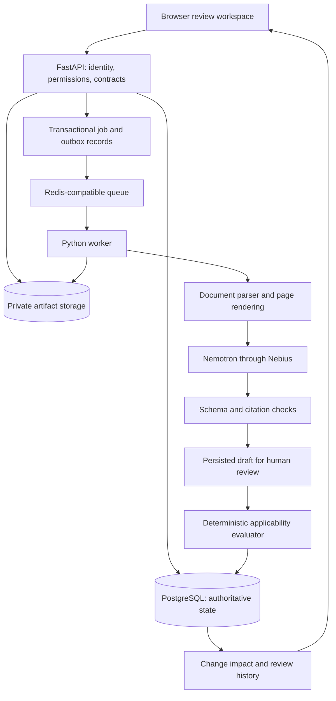
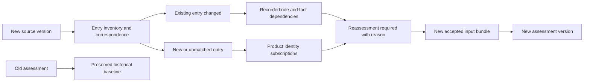
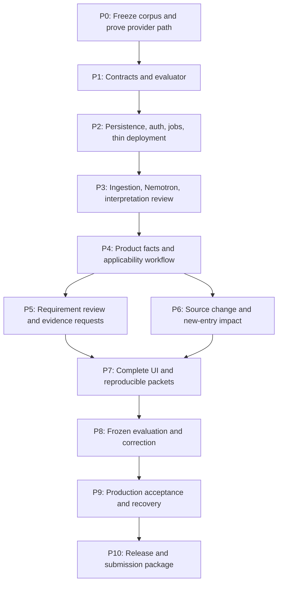

# ErrataScope — Implementation and Execution Plan

Execution update, 29 October 2026: [credits restored](docs/execution/decisions/2026-10-29-credits-restored.md). Current dispatch is [W01 live v2](docs/execution/prompts/W01-LIVE-COMPLETION-V2.md); W02 binding is prepared and follows live acceptance. Earlier temporary deferral is superseded; UI approval remains required.

**Prepared:** 28 October 2026 · **Status:** planning complete; implementation not started.

**Execution update, 29 October 2026:** the human approved a single Codex planner/reviewer with DeepSeek implementation workers. Use [the execution entry point](docs/execution/START_HERE.md) for phase docs, contracts, packet dispatch, and handoffs. The human additionally requires advance notification, Trendshift/GitHub UI inspiration, imagegen mockups, and explicit approval before application UI implementation; [this gate](docs/execution/UI_APPROVAL_GATE.md) overrides any earlier permission to build a UI shell. Independent backend and feasibility work may proceed.

This is the execution companion to [the full research and product proposal](ERRATASCOPE_GAMEPLAN.md). The latest supplied attachment matches that proposal, ignoring whitespace. The proposal remains the source for the broader comparisons and research; this document turns it into a buildable sequence. Choices below are recommended working defaults, not claims of implementation, account access, measured accuracy, or user approval of every dependency.

**Product statement:** ErrataScope turns manufacturer errata and advisories into cited, product-specific applicability assessments, review decisions, and change-driven reassessment.

**First release:** a focused browser application for embedded engineers, with a bounded real-document corpus, essential Nemotron inference through Nebius, a deterministic applicability evaluator, human review, and a complete source-change demonstration.

## Contents

1. [Decisions and scope](#1-decisions-and-scope)
2. [Release contract and demonstrations](#2-release-contract-and-demonstrations)
3. [Architecture and chosen stack](#3-architecture-and-chosen-stack)
4. [Identity, versions, and data model](#4-identity-versions-and-data-model)
5. [Rules and deterministic evaluation](#5-rules-and-deterministic-evaluation)
6. [Document processing and Nemotron](#6-document-processing-and-nemotron)
7. [Review and requirement conflicts](#7-review-and-requirement-conflicts)
8. [Change impact and completeness](#8-change-impact-and-completeness)
9. [API and asynchronous execution](#9-api-and-asynchronous-execution)
10. [Frontend behavior](#10-frontend-behavior)
11. [Security, deployment, and operating costs](#11-security-deployment-and-operating-costs)
12. [Repository and implementation conventions](#12-repository-and-implementation-conventions)
13. [Phase dependencies](#13-phase-dependencies)
14. [Detailed phase execution](#14-detailed-phase-execution)
15. [Evaluation and release acceptance](#15-evaluation-and-release-acceptance)
16. [Submission and demonstration](#16-submission-and-demonstration)
17. [Risks and fallback decisions](#17-risks-and-fallback-decisions)
18. [Post-release expansion](#18-post-release-expansion)
19. [How we execute subsequent turns](#19-how-we-execute-subsequent-turns)
20. [Evidence and source references](#20-evidence-and-source-references)

## 1. Decisions and scope

### 1.1 Protect VerifForge's full planned direction

The boundary is based on VerifForge's future implementation plan as well as its existing implementation. It must survive later expansion into software, CAD, proprietary engineering tools, and hardware-in-the-loop investigation.

| Question or action | Owner | ErrataScope treatment |
|---|---|---|
| What does the manufacturer document say? | ErrataScope | Extract, cite, review, version |
| Does a documented condition match this identified product and its supplied facts? | ErrataScope | Evaluate a restricted rule with uncertainty |
| What evidence is missing or contradictory? | ErrataScope | Open a scoped evidence request |
| Does a documented workaround conflict with an accepted product requirement under supplied facts? | ErrataScope | Show the documentary argument and its assumptions |
| Which previous reviews need attention after a change? | ErrataScope | Track versions and dependencies |
| Does the hardware or program actually behave as described? | VerifForge | Request external evidence; do not execute an investigation |
| Reproduce, simulate, reduce, formally verify, diagnose, patch, or validate a repair | VerifForge | Excluded from ErrataScope |
| Interpret ELF/disassembly, instrument a board, or synthesize test programs | VerifForge territory | Excluded from this product roadmap |

An external report can become evidence with a recorded origin, scope, and review state. Importing it does not mean ErrataScope performed or independently validated the experiment. An optional future integration must leave both products independently usable.

**Feature admission test:** a feature belongs here if it helps identify a manufacturer limitation, establish its documentary applicability, manage evidence or review, or track a changed baseline. If it needs execution to establish behavior, it belongs outside ErrataScope.

This boundary is enforceable through product contracts and code review. No document can guarantee that two evolving projects will never overlap; changes to this boundary must be explicit decisions, not gradual feature creep.

### 1.2 What the first release includes

- Product snapshots with component identity, silicon revision, board revision, firmware/build reference, and operating profile.
- Selected manufacturer PDFs and notices with immutable hashes, versions, and precise source anchors.
- Nemotron-generated draft interpretations; strict schemas; citation checks; a review gate.
- A small typed applicability language and explainable three-valued evaluation.
- Scoped facts, contradictory evidence handling, and actionable missing-evidence requests.
- Restricted workaround/requirement consistency review based on accepted inputs.
- New-document comparison, new-erratum discovery, and affected-review reopening.
- Five connected review views and reproducible JSON/Markdown review packets.
- A public curated demonstration and authenticated project workflow.

### 1.3 Explicitly deferred

General document chat, universal semiconductor coverage, arbitrary web crawling, autonomous engineering decisions, simulations, firmware repair, broad compliance certification, vector search, graph databases, elaborate organizations/billing, custom model training, MCP servers, and multi-agent orchestration. These do not belong on the critical path.

The release makes bounded statements such as “this condition is applicable under the accepted facts and selected source baseline.” It must never translate incomplete coverage into “this board is safe” or “all errata have been cleared.”

## 2. Release contract and demonstrations

### 2.1 Definition of a useful completed release

A reviewer can identify a product, inspect a real source, review a real Nemotron interpretation, assess the selected conditions, resolve or defer missing evidence, inspect a requirement concern, import a changed baseline, and export the history. Every significant conclusion has a path back to its exact inputs.

The first supported corpus is deliberately narrow. Freeze a **coverage manifest** listing source versions, supported erratum IDs, unsupported sections, and extraction/review states. A document being uploaded does not mean every entry has been processed.

### 2.2 Demonstration A — applicability and an unresolved workaround interaction

Use ST's STM32N6 errata and the recent STM32N657 reset/power-hold discussion as the source context. The current source inspected during planning is ES0620 Rev 5, 38 pages. Verify the downloaded copy and relevant sections during Phase 0. A revision-identification limitation in the same document makes exact identity evidence a meaningful part of the demonstration. [ST errata](https://www.st.com/resource/en/errata_sheet/es0620-stm32n6xxxx-device-errata-stmicroelectronics.pdf)

The published discussion describes a revision B reset workaround interacting with a power-hold arrangement. It is motivation and a technical clarification, not proof that a particular board has been validated. [ST discussion](https://community.st.com/stm32-mcus-products-25/stm32n657-revision-b-nrst-workaround-without-an-initial-software-reset-168780)

Use a clearly labeled example product:

1. Unknown silicon revision produces an unresolved target match.
2. Accepted revision evidence resolves identity.
3. Missing operating conditions leave applicability unresolved where relevant.
4. Accepted facts allow a bounded conclusion.
5. A supplied requirement and supplied incompatibility fact expose a workaround concern.
6. The engineer requests external validation instead of the application inventing a physical explanation.

Synthetic board facts must be labeled as fixtures. Do not present them as measurements from the real forum author's board.

### 2.3 Demonstration B — a previously reviewed product needs attention

NXP's October 2026 i.MX 8M Mini notice announces an errata revision from 1.2 to 1.3 and newly added errata. It supports the need for new-entry discovery, not just diffing previously matched sections. The notice alone is insufficient to construct the full technical conditions: obtain the underlying documents. [NXP notice](https://www.nxp.com/pcn/202609010I)

Preferred demonstration: authentic older and newer manufacturer documents with recorded retrieval metadata. If an authentic pair cannot be obtained, demonstrate the change engine with a separately labeled synthetic fixture and retain the real notice only as motivation. Never fabricate an “old manufacturer revision.”

Expected sequence:

1. Complete an assessment against baseline A.
2. Import baseline B.
3. Identify added, changed, removed, and ambiguously matched entries.
4. Match new entries to watched product identities, including products with no prior dependency on that entry.
5. Reopen affected reviews with a reason.
6. Preserve the original decision and export the before/after record.

### 2.4 What makes the product distinctive

The product hypothesis is the combination of exact identity, cited conditions, scoped evidence, human decisions, and ongoing reassessment. Rule extraction and three-valued logic alone are not a defensible novelty claim; adjacent tools already use them. The submission should demonstrate the whole lifecycle and report its limits honestly.

## 3. Architecture and chosen stack

### 3.1 Working defaults

| Layer | Default | Why it is in the release | Reconsider only if |
|---|---|---|---|
| Browser | React, Vite, TypeScript | Rich review workspace with a separate Python API | A concrete requirement needs server rendering |
| Routing and state | React Router; TanStack Query | Shareable views and consistent server state | Compatibility spike identifies a real blocker |
| Tables and controls | TanStack Table; one shadcn/ui-based component system | Filtering, review actions, accessible controls | Design workflow selects a compatible alternative |
| Source viewer | PDF.js | Page navigation and source-linked highlights | Corpus fails the rendering/coordinate spike |
| API | FastAPI, Pydantic | Typed contracts close to Python extraction code | No speculative framework migration |
| Persistence | PostgreSQL, SQLAlchemy, Alembic | Versions, relationships, transactions, migrations | Local-only edition becomes a distinct future product |
| Jobs | RQ; Redis-compatible broker, Valkey locally | Separate bounded document/model work from requests | Compatibility or measured workflow complexity requires a change |
| Parsing | Docling, with a recorded pdfplumber fallback | Layout/table extraction plus inspectable text fallback | Real corpus evaluation rejects the parser |
| Inference | Direct Nebius API adapter with Pydantic validation | Essential Nemotron interpretation; controlled calls | Provider/model compatibility tests require another eligible NVIDIA model |
| Artifacts | Storage adapter: filesystem locally; private object storage hosted | Original files, page renders, exact model outputs, exports | Deployment environment dictates another compatible store |
| Auth | Supabase Auth for hosted application | Managed identity and JWT verification | Account/region/deployment feasibility requires another OIDC provider |
| Hosted candidate | Render web/API and worker; managed Redis-compatible broker; Supabase PostgreSQL/Auth/Storage | Persistent worker and managed state with clear responsibilities | Phase 0 finds a cost, region, availability, or account blocker |
| Tests | pytest; Vitest; Playwright; selected property-based evaluator tests | Logic, integration, review journeys, browser evidence | Tests duplicate implementation without checking behavior |

These are coherent defaults, not an obligation to buy services. Verify service availability, plan limits, regions, and account access before provisioning. A single Linux VM running the same application containers is a viable fallback. Do not add a second application backend merely because a frontend hosting provider offers one.

Use Linux containers locally through Docker Desktop/WSL where available, matching production worker behavior. Select and pin compatible Python/Node runtimes during the feasibility spike; Python 3.12 is a candidate, not a claim about the latest release. Commit lockfiles and a reproducible container build after testing the parser/model SDK combination.

### 3.2 Service boundaries



Keep domain modules in one backend codebase, deployed as API and worker processes. The database owns business state. The broker only schedules work. Model interpretation is separated from deterministic evaluation; reproducing an accepted assessment must not require another model call.

## 4. Identity, versions, and data model

### 4.1 Immutable content; append-only decisions

Product snapshots, document bytes, rule versions, fact sets, and assessment inputs are immutable once sealed. Editing creates a new version. Review actions and invalidation events append history. Mutable projections may show current status, but must be reconstructible from those records.

An assessment pins:

```text
assessment_id
project_id
product_snapshot_id + snapshot_content_hash
fact_set_id + accepted fact version IDs
source_baseline_id + document version IDs
coverage_manifest_id
accepted rule version IDs
evaluator_version + rule_schema_version
result artifact hash
created_at, actor_id
```

The fact set is separate from the product snapshot so additional evidence can produce a new assessment of the same physical/configuration identity without rewriting it.

### 4.2 Initial entities

| Entity | Required fields and relationships |
|---|---|
| Project / Membership | Owner, visibility, member identity, role |
| ProductSnapshot | Product, board revision, build reference, profile, predecessor, sealed hash |
| ComponentInstance | Snapshot, reference designator, exact manufacturer/part, family, package, revision, identity evidence |
| FactSet / FactVersion | Scope, selector, typed value/unit, origin kind, source evidence, review reference, predecessor |
| EvidenceArtifact | SHA-256, media type, size, storage key, origin, access classification |
| Document / DocumentVersion | Stable document identity, revision, publication/retrieval dates, hash, source URL, authority, supersession |
| SourceAnchor | Document version, physical page index, printed page label, section, text span, bounding box, parser version |
| Erratum / ErratumVersion | Stable manufacturer ID, document-specific section/title, correspondence review |
| RuleVersion | Typed AST, target/trigger/exception/workaround fields, anchors, extraction run, schema version |
| RuleReview | Accept/revise/defer/reject, reviewer, rationale, exact reviewed hash |
| CoverageManifest | Baseline, discovered entries, supported/reviewed/failed/unsupported entries, scan completeness |
| RequirementVersion | Product scope, declared constraint, supporting evidence, review status |
| Assessment / AssessmentItem | Frozen inputs, applicability dimensions, traces, missing/contradictory evidence |
| ReviewDecision | Assessment/item, disposition, rationale, actor, timestamp, superseded decision |
| EvidenceRequest | Selector, required scope, blocking items, requested evidence, owner, resolution |
| Dependency / IdentitySubscription | Input/output edges, referenced selectors, watched component families and baselines |
| DocumentComparison / ChangeEvent | Old/new versions, correspondence, added/changed/removed items, review state |
| Job / JobAttempt / Outbox / Event | Durable state, idempotency, attempts, lease, dispatch, ordered progress |
| ModelCall / ExtractionRun | Provider/model ID, request/output artifact hashes, prompt/schema/parser versions, usage, timing, outcome |

Relational columns hold ownership, IDs, versions, and lifecycle state. JSONB holds validated condition trees and trace payloads. Original model responses remain separate byte artifacts. PostgreSQL JSONB is useful for structured querying, but does not preserve original textual formatting. [PostgreSQL JSON documentation](https://www.postgresql.org/docs/current/datatype-json.html)

### 4.3 Constraints and indexes that matter

- Unique immutable content identity within the intended project/source scope; do not leak cross-project deduplication information.
- Unique idempotency key per project, actor, and operation, with request-body hash checking.
- Unique accepted artifact per job stage/input hash; retries must not create duplicate results.
- Foreign keys prevent dangling rule/source/fact references; project checks prevent cross-project links.
- Index project + creation time, snapshot + assessment time, document + revision, exact manufacturer erratum ID, dependency input, fact selector + scope, job status + lease expiry.
- Explicit transaction boundary for review acceptance and for assessment sealing.
- Optimistic concurrency/version checks on competing reviews; return a conflict instead of overwriting another reviewer.
- Timestamps use UTC internally; display local time with its timezone.

### 4.4 Evidence scopes

A fact is not simply `reset_allowed = false`. Its key includes component/product subject, board revision, build, operating mode, environment where material, and applicable time/baseline.

Different scopes can legitimately contain different values. Contradictions arise only after scope resolution. Multiple incompatible accepted values for the same required selector produce a conflict requiring review; do not pick the newest value automatically.

“Measured” describes the evidence origin, not independent validation by ErrataScope. Reviewer acceptance records that the evidence is accepted for this assessment, not a guarantee of physical truth.

## 5. Rules and deterministic evaluation

### 5.1 Separate the questions

Maintain target identity match, trigger-condition match, exceptions, and resulting applicability. Keep workaround documentation and product implementation evidence separate from applicability.

| Dimension | States |
|---|---|
| Applicability | applicable / not_applicable / unknown |
| Evidence | supported / missing / contradictory / unsupported_interpretation |
| Workaround documentation | available / partial / none_documented / unclear |
| Requirement consistency | no_conflict_identified / conflict_under_supplied_facts / unresolved |
| Review disposition | draft / accepted / deferred / rejected / superseded |
| Freshness projection | current_against_selected_baseline / reassessment_required |

An accepted applicability assessment can still have an unresolved workaround concern. An old decision can remain historically valid against its old inputs while needing reassessment against the current baseline.

### 5.2 Rule language v1

Support only typed `eq`, `in`, numeric bounds with an explicit supported unit vocabulary, `all`, `any`, and `not`. Require declared fact selectors and source anchors. Support exceptions explicitly rather than hiding them in prose. Unrecognized operators, ungrounded predicates, and unsupported units block rule activation.

Illustrative synthetic rule, not a transcription of an actual manufacturer entry:

```json
{
  "schema_version": "1",
  "erratum_id": "SYNTHETIC-RESET-01",
  "target": {
    "op": "all",
    "args": [
      {"op": "eq", "fact": "component.part", "value": "DEMO-MCU", "anchors": ["a1"]},
      {"op": "in", "fact": "component.silicon_revision", "values": ["B"], "anchors": ["a2"]}
    ]
  },
  "trigger": {"op": "eq", "fact": "profile.external_reset_used", "value": true, "anchors": ["a3"]},
  "exceptions": [],
  "workaround": {"documentation": "available", "anchors": ["a4"]}
}
```

No arbitrary Python, JavaScript, SQL, shell, solver programs, or model-generated executable expressions. This evaluator is a document-condition matcher, not a general verification engine.

### 5.3 Three-valued semantics

| A | B | A AND B | A OR B |
|---|---|---|---|
| true | true | true | true |
| true | false | false | true |
| true | unknown | unknown | true |
| false | false | false | false |
| false | unknown | false | unknown |
| unknown | unknown | unknown | unknown |

Negation preserves unknown. Missing or contradictory evidence makes the affected leaf unknown. Preserve explanatory warnings even when another condition proves the overall conjunction false. Do not force every result to unknown merely because an irrelevant fact is missing.

For an accepted rule, compute `target_match AND trigger_match AND NOT(any_exception_matches)` using the same three-valued semantics. An explicitly unconditional trigger is true; an explicitly reviewed empty exception list contributes false to `any_exception_matches`. Missing extraction fields are not empty lists or unconditional triggers: they block activation until reviewed. Show these intermediate values so a reviewer can distinguish an unaffected revision from a relevant device whose trigger is unresolved.

Coverage failure is different: if an erratum was never extracted or its interpretation is unsupported, it is not a successfully evaluated “not applicable” item. It remains visibly outside accepted assessment coverage.

### 5.4 Evaluator output and dependency completeness

Return the result, each evaluated predicate, facts and anchors used, missing selectors, contradictions, and coverage status. Register **all declared selectors**, including branches skipped by short-circuit evaluation. Register missing selectors as dependencies so newly supplied evidence can reopen an unknown result.

Evaluation must be deterministic for the same accepted input bundle and evaluator version. Store a canonical result hash excluding incidental timestamps. Re-running extraction creates a new interpretation version; it does not silently replace the rule used by an old assessment.

## 6. Document processing and Nemotron

### 6.1 Ingestion pipeline

1. Accept an upload or an explicitly supported manufacturer URL.
2. Check file type, size, page limits, access policy, and source metadata.
3. Store original bytes and SHA-256 before transforming anything.
4. Extract pages, sections, tables, headers, footnotes, and document identity.
5. Build a document entry inventory and initial coverage manifest.
6. Create source anchors and page renders where needed.
7. Send bounded relevant sections to Nemotron with schema and source IDs.
8. Validate schema and source references; mark ambiguous interpretations.
9. Persist draft rules and a review task.
10. Activate only accepted rule versions, then assess selected product facts.

Start with digitally generated PDFs. Treat scanned pages as a gated capability: use OCR/vision only after verifying its output on the chosen corpus. Preserve which parser or OCR path produced each anchor. A fallback is explicit provenance, not an invisible parser swap.

Coordinate tests must cover rotation, crop boxes, page numbering, table cells, and surrounding headers/footnotes. A bounding box that highlights the wrong line can undermine an otherwise correct interpretation.

### 6.2 Essential model responsibility

Nemotron drafts affected identities, trigger conditions, exceptions, workaround restrictions, source-linked structured predicates, and candidate change summaries. It does not decide product safety, invent missing board behavior, accept its own rules, or directly mutate authoritative facts.

The current documented candidate is **`nvidia/Nemotron-3.5-Super-VL`**, served through **`https://api.tokenfactory.nebius.com/v1/`**. Nebius announced it on 16 October 2026. Its availability to this account and compatibility with the exact structured/vision requests remain untested. [Nebius announcement](https://nebius.com/blog/posts/three-new-open-weight-models-from-us-companies-give-builders-more-choice), [API quickstart](https://docs.tokenfactory.nebius.com/quickstart)

Use the OpenAI-compatible client transport with the Nebius base URL and selected NVIDIA model. That client choice does not mean OpenAI performs runtime inference. Coding the application with Codex is separate from the runtime model requirement.

### 6.3 Phase 0 provider experiment

When implementation begins, make one bounded real request on a selected section and record:

- Available exact model ID and response metadata.
- Successful text request and, if required, documented page-image input.
- Supported structured-output/JSON mode and schema behavior.
- Output token needs, truncation behavior, latency, usage fields, rate-limit/error behavior.
- Citation fidelity and handling of table headers/footnotes.
- A negative fixture where the model should leave a condition unresolved.

Do not postpone this experiment until the application is otherwise complete. If strict schema output is unavailable for the chosen model, accept a text response only through server-side parsing/validation and the same review gate. Invalid output must fail visibly; it must not become an accepted partial rule. [Nebius JSON guidance](https://docs.tokenfactory.nebius.com/ai-models-inference/json)

### 6.4 Grounding and bounded retries

Every technical condition needs valid anchors to the original version. Check IDs, page bounds, quoted-text presence where text extraction permits it, and table context. These checks establish traceability; they do not establish semantic correctness. Human review remains necessary.

Treat document instructions as untrusted source content. The extraction model has no shell, arbitrary network, or database-writing tool. A source saying “ignore previous instructions” is document text.

Initial configurable limits: 25 MiB per file, 100 pages, two concurrent extraction jobs per project, one schema-repair attempt, and at most two transient retries. Calibrate parsing and model timeouts during the real-corpus spike. Set finite token/output budgets; overly short output limits can truncate useful answers or exhaust reasoning without a usable final response. Limits are operating defaults, not benchmark results.

Store request/output artifacts, model ID, prompt/schema/parser versions, parameters, finish reason, latency, provider request ID when available, and usage. Cache only by complete input/configuration hash and applicable access scope. A cached demonstration must be labeled; it cannot be presented as a fresh live model call.

## 7. Review and requirement conflicts

### 7.1 Two review gates

**Interpretation review:** verify that the rule correctly expresses the cited source, including affected revisions, exceptions, and restrictions. An edit creates a new rule version and requires review of that exact hash.

**Product decision review:** accept, defer, or reject a finding for the selected product scope, record rationale, and retain open evidence requests. Accepting the source interpretation does not automatically accept every product conclusion.

Draft facts/rules can support an explicitly provisional preview. An accepted assessment must record which input policy it used and must not silently incorporate unreviewed model output. Facts accepted as declarations remain labeled declarations.

### 7.2 Restricted requirement consistency

Represent a documented action, a scoped product requirement, and any supplied fact establishing their incompatibility. Report a conflict only when that relationship is explicit in accepted inputs. If a physical behavior must be inferred or tested to connect them, report unresolved and request that evidence.

Example: a source requires an action; a product requirement prohibits a specific interruption; an external accepted report says that action causes the prohibited interruption in the relevant build/mode. ErrataScope can display the argument. Without the report, it must not invent the causal step.

Do not introduce temporal model checking, simulated traces, or generic counterexample reduction. A short explanation listing the contributing source clauses and facts is sufficient.

### 7.3 Evidence requests

Each request identifies the missing selector, component/snapshot/profile, why it matters, an acceptable evidence type, blocking assessments, owner, and resolution history. Submission of evidence creates a candidate fact; review resolves the request and schedules reassessment.

Associate a request with the exact missing-evidence condition, not merely free-text wording. Requests that appear similar but refer to different boards, builds, or modes must remain separate. Closing a request requires an accepted resolution or an explicit disposition; a file upload alone is insufficient.

Prioritize requests transparently: dependent assessments first, then declared consequence severity, then estimated acquisition effort. Show those inputs rather than an invented probability. Automated reminders and external messages are outside this release unless separately authorized.

## 8. Change impact and completeness

### 8.1 Comparison stages

1. Compare source identities and hashes.
2. Match stable manufacturer erratum IDs; use section/title similarity only to suggest correspondence.
3. Classify additions, removals, textual changes, reordering, and ambiguous matches.
4. Generate candidate semantic differences with source links.
5. Require review for changed interpretations and uncertain correspondence.
6. Determine affected product families, snapshots, selectors, rules, and decisions.
7. Append invalidation/review events; create new assessments after accepted inputs are ready.

Section renumbering is not automatically a new erratum. A missing section is not automatically a resolved defect. A changed URL with identical bytes is not automatically a technical change.

### 8.2 The new-entry problem

Dependency edges alone cannot detect a brand-new erratum: no old assessment depends on it yet. Maintain identity subscriptions connecting products to manufacturer families, documents, and selected baselines. On a new or uncertain catalog entry, match those subscriptions and reopen the relevant coverage/review state.



Until correspondence is resolved, a conservative family-level “baseline review pending” state is better than falsely claiming the product is current. A model's “no material change” statement alone cannot clear freshness.

### 8.3 Coverage as a visible contract

Display separately: document inventory complete/incomplete; entries discovered; entries supported; interpretations reviewed; items assessed; items unresolved; entries failed or unsupported. Preserve the selected manifest in exports.

If the demonstration covers six selected entries in a 38-page document, say so. A percentage of reviewed selected entries must never masquerade as a percentage of all product risks eliminated.

## 9. API and asynchronous execution

### 9.1 Initial API contract

| Endpoint group | Operations and guarantees |
|---|---|
| `/projects`, `/projects/{id}/members` | Membership, role, visibility; enforce project scope |
| `/projects/{id}/snapshots` | Create draft; seal immutable snapshot; read predecessor |
| `/snapshots/{id}/fact-sets` | Add scoped candidate facts; accept versions; seal set |
| `/documents`, `/document-versions/{id}/extract` | Register artifact; start bounded extraction; return job ID |
| `/document-versions/{id}/anchors` | Authorized page/source references |
| `/rule-versions/{id}/reviews` | Append review of exact hash with concurrency protection |
| `/assessments` | Pin accepted input bundle; evaluate; return immutable result |
| `/assessments/{id}/decisions` | Append product review disposition and rationale |
| `/document-comparisons`, `/{id}/impact` | Compare source versions; expose affected scope |
| `/evidence-requests/{id}/responses` | Submit evidence; require fact review before resolution |
| `/assessments/{id}/exports` | Generate immutable packet manifest and artifacts |
| `/jobs/{id}`, `/jobs/{id}/events` | Durable status; ordered events; polling first |

Use JSON error envelopes containing stable error code, user-readable message, field details, and request ID. Distinguish authentication, authorization, conflict, unsupported input, provider failure, and retryable infrastructure errors. Long operations return HTTP 202 and a job resource. Add server-sent events only after durable polling works; SSE is not the source of job truth.

### 9.2 Reliable jobs

Write the job and outbox message in one database transaction. A dispatcher delivers the outbox item to the broker. A reconciler can retry undispatched work and recover stale leases. Workers claim attempts and commit stage outputs idempotently.

Suggested states: queued → running → succeeded / failed / cancelled. A business workflow waiting for human review is persisted separately as `awaiting_review`; it must not hold a worker process open.

Expect at-least-once delivery. Use attempt tokens/leases so a late worker cannot overwrite a newer successful attempt. A retry after an uncertain provider response may incur another model charge; application idempotency cannot guarantee exactly-once billing at an external provider.

Cancellation stops future stages and attempts to cancel current work when supported. It cannot undo an already completed model call. Preserve diagnostic metadata without logging credentials or full private document contents by default.

## 10. Frontend behavior

Use the required design-first workflow before substantial UI implementation. Establish a coherent evidence-review screen and its states, then expand the remaining views. Do not implement a collection of unrelated dashboards.

| View | Required interactions | Important states |
|---|---|---|
| Product snapshot | Exact identities, provenance, scope, seal/new version | Unknown revision; ambiguous match; conflicting facts |
| Assessment list | Filter applicability, review, freshness; show coverage | Loading, empty corpus, unsupported entries, stale baseline |
| Evidence workspace | Source + interpretation + product facts; accept/revise/defer | Draft interpretation, missing anchor, contradictory evidence |
| Change review | Before/after source, correspondence, affected products | Added entry, ambiguous match, review pending, unchanged bytes |
| Review packet | Rationale, source baseline, unresolved requests, export | Export in progress, permissions, reproducibility metadata |

The primary flow is `Identify → Review interpretation → Assess → Resolve evidence → Review changes → Export`. Chat is not needed for the first release.

Desktop evidence workspace: three coordinated panes, with a compact decision area. Smaller screens can use tabs preserving the same context. Keep the selected snapshot/baseline visible. Every condition opens its source anchor. Use text/icons as well as color. Review buttons need pending and conflict states; a double click must not create duplicate decisions.

Do not overbuild a PDF editor. Support page navigation, source highlights, table context, and evidence links. Exact part/erratum search and basic full-text search are sufficient initially.

## 11. Security, deployment, and operating costs

### 11.1 Access model

Initial roles: owner, reviewer/editor, viewer. Keep the public curated demo separate from private projects. Public visitors can inspect a prepared example; any live extraction route is bounded and rate-limited. Do not expose unlimited anonymous model spending.

Verify hosted JWT signatures, issuer, audience, expiry, and allowed algorithm using the provider's current documented verification path. Do not merely decode a JWT. Enforce project membership for every database operation and artifact download.

For Supabase, application tables can live behind the Python API in a private schema with an explicitly scoped database role. If any table is exposed through Supabase APIs, enable and test appropriate RLS. Privileged server credentials can bypass RLS: application authorization remains mandatory. Keep storage private and issue short-lived authorized download links. Consult current Supabase documentation/changelog before implementation, including connection mode and migration-role requirements. [JWT guidance](https://supabase.com/docs/guides/auth/jwts), [database connections](https://supabase.com/docs/guides/database/connecting-to-postgres), [Storage access control](https://supabase.com/docs/guides/storage/security/access-control)

Loopback-only development identity is acceptable for local tests; hosted startup must fail closed if auth configuration is missing. A development bypass must not become a deployment default.

### 11.2 Input and artifact controls

- Treat uploaded files and retrieved text as data, never executable instructions.
- Initially accept PDFs and constrained structured fact files; do not accept arbitrary archives or firmware executables.
- Restrict URL imports to supported manufacturer sources; validate redirects and block private/internal network targets.
- Bound file sizes, pages, render dimensions, parser time, concurrency, and model calls.
- Isolate parsing in the worker with bounded resources; use patched, pinned dependencies.
- Sanitize rendered Markdown/HTML, authorize every artifact, and use safe download disposition.
- Keep API credentials server-side; redact secrets from logs and exported model metadata.
- Preserve evidence retention/history rules. A future deletion mechanism must explicitly handle references and tombstones, not silently rewrite old findings.

### 11.3 Deployment plan

Local Compose: PostgreSQL, Valkey, API, worker, and optional frontend dev service; private artifacts on a local volume. Production: built frontend, API, worker, broker, managed database, and object storage. Use the same parser and evaluator container image in local and hosted execution where practical.

Deploy a thin authenticated slice early, during Phase 2. Test production document-worker memory, outbound inference, artifact access, and database connectivity before the full UI is finished. Worker hosting is a separate deployment responsibility. [Render background-worker documentation](https://render.com/docs/background-workers)

Deployment gates: migrations complete, health endpoints distinguish liveness/readiness, auth configured, secrets absent from client bundle, storage permissions verified, model budget configured, backup/restore procedure exercised, restart recovery tested. Choose the correct database pooling/direct connection mode for runtime and migrations during the hosting spike.

### 11.4 Cost model and observability

Track per model call: input/output tokens and other provider-reported usage, latency, retries, failure class, cache status, and estimated cost. Track per job: parse duration, queue delay, worker memory, pages, extracted entries, and review outcomes. Avoid placing raw private documents into general logs.

The October model announcement lists $0.30 per million input tokens and $0.90 per million output tokens for the selected candidate. Under that published text-token pricing, 40,000 input and 4,000 output tokens would be approximately **$0.0156**, before retries and any differing modality/account billing. Verify actual usage and account pricing; this is arithmetic, not a cost forecast. [Nebius announcement](https://nebius.com/blog/posts/three-new-open-weight-models-from-us-companies-give-builders-more-choice)

Total operating cost also includes API/worker uptime, database, storage, broker, and egress. Token Factory credits do not establish that those other services are funded. Never publish the promotional code from the supplied screenshot. Use configurable per-job/project caps and retain enough budget for a real final demo.

## 12. Repository and implementation conventions

Proposed layout; these directories are not yet application implementation:

```text
ErrataScope/
  ERRATASCOPE_GAMEPLAN.md
  IMPLEMENTATION_EXECUTION_PLAN.md
  docs/
    EXECUTION_STATUS.md
    decisions/
    contracts/
    evaluation/
    deployment/
  apps/web/src/
    routes/ components/ features/ api/
  backend/
    src/erratascope/
      api/ auth/ sources/ products/ extraction/
      rules/ evidence/ assessments/ changes/
      reviews/ jobs/ exports/ storage/
    migrations/
    tests/unit/ tests/integration/
  tests/e2e/
  fixtures/synthetic/
  fixtures/manifests/
  scripts/
  infra/
  references/
  visuals/
```

Keep model prompts and schemas versioned. Generate TypeScript API contracts from the backend OpenAPI schema, checking breaking changes in CI. Use typed domain enums shared through generated contracts, not independently spelled strings across frontend/backend.

Use UUID identifiers, canonical serialization for content hashes, explicit schema versions, and immutable artifact naming. Repository fixtures should be original synthetic material or material with suitable redistribution permission. Publicly accessible manufacturer PDFs are not automatically licensed for republication; use source manifests/download instructions when redistribution rights are unclear.

Choose an application source license before public release and audit dependency/model licenses. A permissive application license does not relicense manufacturer documents or model weights. Record reused components and their provenance separately from newly implemented work.

## 13. Phase dependencies

The phases are ordered by risk and dependencies, not an artificial hourly timetable. A failed exit gate keeps its phase open. A polished UI does not compensate for a broken grounding or change-impact gate.



Security, deployment, and evaluation begin early and deepen throughout. P9 is the final acceptance pass, not the first deployment. Independent work streams may exist after their contracts are stable; this plan does not require multi-agent execution.

## 14. Detailed phase execution

### P0 — Feasibility, corpus, and boundary freeze

**Inputs:** this plan, prior proposal, eligible provider access, proposed source URLs.

**Tasks:** record the product boundary; fetch and hash a narrow corpus; verify exact affected revisions and source authority; obtain authentic old/new documents or label the synthetic fallback; define coverage; inspect available runtimes; test parser + PDF coordinates; make a bounded real NVIDIA/Nebius request; check hosted account/region/cost feasibility; audit initial licensing constraints.

**Deliverables:** architecture decision record, source manifest, provider spike record with usage, parser inspection samples, draft evaluation cases, deployment choice, supported predicate vocabulary.

**Exit gate:** at least one real source section produces an inspectable, cited draft via the intended runtime model; source rendering is trustworthy enough for review; the final change demo has an honest provenance plan; the hosting route is feasible.

**If blocked:** reduce the source subset, repair the parser adapter, or select another eligible NVIDIA model actually available through Nebius. Do not silently substitute a noneligible runtime or begin a large UI before resolving the core path.

### P1 — Domain contracts and pure evaluator

**Inputs:** frozen initial vocabulary and selected source examples.

**Tasks:** define Pydantic contracts for identities, scopes, facts, rules, coverage, traces, and assessments; implement pure typed evaluation and canonical hashes; define exact truth tables; reject unsupported expressions; preserve all selector dependencies.

**Deliverables:** versioned JSON schemas, synthetic fixtures, evaluator package, example trace, domain error catalog.

**Exit gate:** truth tables, missing/contradictory evidence, irrelevant unknowns, units, scope, exceptions, unsupported predicates, and deterministic replay pass meaningful tests. Dependency tests include short-circuited and missing selectors.

**If blocked:** reduce the supported predicate vocabulary and label unsupported entries. Never coerce uncertainty to false merely to complete the pipeline.

### P2 — Persistent foundation and thin deployment

**Inputs:** stable core contracts.

**Tasks:** scaffold application packages and migrations; implement project authorization, artifact storage, job/outbox/attempt state, idempotency and event polling; configure local containers; create minimal frontend shell through the required design workflow; deploy a thin authenticated slice when hosting is authorized/available.

**Deliverables:** clean startup instructions, migrations, health checks, project/document/job APIs, role checks, local and hosted configuration templates, CI baseline.

**Exit gate:** a clean environment can create a project, store a private artifact, enqueue a harmless job, restart a worker, and retrieve the result; another project/user cannot access it; retries do not duplicate accepted artifacts.

**If blocked:** resolve one deployment path rather than supporting several providers at once. Use local artifacts for development while preserving the storage interface; private hosted uploads remain disabled until auth/storage gates pass.

### P3 — Source ingestion, live interpretation, and review

**Inputs:** P0 corpus/provider findings; P2 durable infrastructure.

**Tasks:** implement ingestion, document inventory, anchors, parser provenance, Nemotron adapter, bounded retries, citation checks, extraction-run records, and a minimal interpretation-review screen. Include a live/cached indicator and full source context.

**Deliverables:** real source → persisted draft rule → accepted rule workflow; coverage manifest; source viewer with verified coordinates; model-call audit record.

**Exit gate:** the reviewer can inspect every predicate's source, reject a bad interpretation, accept a correct version, and see unsupported entries. Invalid JSON, missing citations, truncated output, provider timeout, and prompt injection fixtures cannot activate a rule.

**If blocked:** narrow to the proven digital-text subset or supported page images. Keep failed extraction visible. Do not replace all model work with hand-authored rules and describe the result as live extraction.

### P4 — Product identity, evidence, and applicability

**Inputs:** accepted rules and working evidence viewer.

**Tasks:** implement snapshot sealing, exact component identity, scoped facts/fact sets, review of facts, assessment input bundles, trace rendering, coverage-aware lists, and provisional preview versus accepted assessment behavior.

**Deliverables:** product snapshot view, assessment list, evidence workspace, deterministic replay command or API.

**Exit gate:** demonstrate applicable, not-applicable, missing revision, contradictory evidence, and incomplete coverage cases; changing a fact creates a new assessment without changing the old one; a declared fact stays visibly declared.

**If blocked:** reduce supported product configuration fields, preserving unknown values and scope. Do not approximate exact silicon revision from a family/BOM match.

### P5 — Requirement consistency and evidence requests

**Inputs:** stable accepted assessments and scoped evidence.

**Tasks:** add versioned product requirements, restricted incompatibility relationships, explanatory supporting facts, evidence request ownership/resolution, and transparent prioritization.

**Deliverables:** conflict-under-supplied-facts panel, unresolved alternative, request lifecycle, reassessment after accepted evidence arrives.

**Exit gate:** a complete accepted argument reports a scoped conflict; removing its causal evidence yields unresolved; different scopes do not create a false conflict; resolving one request reopens all appropriate blocked assessments.

**If blocked:** ship an explicit unresolved evidence request instead of an invented engineering conclusion. No simulation or execution workaround is added.

### P6 — Document changes and new-entry impact

**Inputs:** two source versions or clearly labeled controlled fixtures; existing assessments.

**Tasks:** implement stable entry correspondence, additions/removals/renumbering, candidate semantic diffs, correspondence review, dependency invalidation, identity subscriptions, and freshness projections.

**Deliverables:** change-review view, impact list with reasons, preserved history, new-baseline reassessment.

**Exit gate:** a changed existing rule reopens dependents; a new erratum reaches a matching product with no previous edge; an unrelated product stays unchanged when correspondence is established; ambiguous matches remain pending; old decisions retain their original input bundle.

**If blocked:** conservative family-level review pending is acceptable with a reason. Silently marking an uncertain source baseline current is not.

### P7 — Complete workflow and review packets

**Inputs:** P5 and P6 capabilities.

**Tasks:** finish the five views, empty/error/loading states, navigation, accessibility, JSON and Markdown export, artifact manifest, and deterministic replay entry point. Add an optional printable view only after the core packet works.

**Deliverables:** complete product journey and an export bundle containing sources/anchors, accepted rule/fact versions, coverage, traces, decisions, open requests, evaluator version, and hashes. Include original documents only where access and redistribution rights permit.

**Exit gate:** a fresh local environment can replay the assessment from an authorized packet without a model call and match the canonical result hash; missing restricted source bytes are declared; links and permissions work; export does not omit uncertainty.

**If blocked:** retain JSON + readable Markdown rather than spending the critical path on elaborate PDF layout. Reproducibility and source traceability take priority over presentation extras.

### P8 — Frozen evaluation and evidence of limitations

**Inputs:** frozen supported corpus, schemas, and model configuration.

**Tasks:** finalize independent ground truth, split development/held-out source groups, run automated extraction separately from human-assisted outcomes, evaluate deterministic rules/change impact, record latency/cost, inspect all dangerous errors, and fix regressions.

**Deliverables:** versioned evaluation report, raw result records, reproducible commands, failure examples, honest supported-scope statement.

**Exit gate:** no unexplained false “not applicable” outcome in the release fixtures; deterministic and change-impact gates pass; failed extraction remains in denominators; the report distinguishes pre-review model performance from post-review workflow performance.

**If blocked:** narrow claims and supported coverage, repair the issue, and rerun affected evaluation. Do not repeatedly tune on the held-out set while continuing to call it unseen.

### P9 — Production acceptance and recovery

**Inputs:** release-candidate application and P8 evidence.

**Tasks:** exercise the hosted user journey, authorization boundaries, private artifacts, model budgets, queue recovery, failed provider calls, migrations, clean install, backup/restore, and mobile/keyboard review essentials. Verify actual runtime model/provider metadata.

**Deliverables:** deployment/runbook, known limitations, operational configuration, release acceptance record, stable demo URL.

**Exit gate:** the clean hosted demonstration and local reproduction both work; worker interruption cannot lose accepted work; repeated requests cannot create conflicting accepted results; demo access and spending limits behave as documented.

**If blocked:** disable only the failing optional capability and document it. Core grounding, access control, runtime eligibility, and the main review/change lifecycle cannot be waived.

### P10 — Release and submission package

**Inputs:** accepted release candidate, evaluation report, stable deployment.

**Tasks:** finalize README/license/setup/source manifests, clarify newly built work and any reuse, prepare a public video under three minutes, provide testing instructions, model/provider feedback, chosen track, and submission fields; record the release commit and deployment version.

**Deliverables:** reviewable submission package and link checklist. Actual external submission is a separate authorized action; preparing it is part of the implementation plan.

**Exit gate:** repository, demo, and video links work without the developer's session; reviewers can reproduce the main result; claims match the evaluated release; the provider/model integration is visible and accurate.

**If blocked:** fix access or documentation before submitting. Do not claim submission occurred until the platform confirms it.

## 15. Evaluation and release acceptance

### 15.1 A small but meaningful initial set

Target approximately 30 case scenarios across six distinct erratum/source-condition groups. A possible split is four groups/20 development cases and two groups/10 held-out cases. Keep all variants of the same underlying condition in one split. If there are too few independent groups, describe the evaluation as a bounded case study rather than evidence of broad generalization.

Cover true/false/unknown conditions, missing identity, conflicting facts, scope mismatch, exceptions, partial workarounds, footnotes, unsupported predicates, malformed model responses, renumbered entries, newly added entries, removed entries, and changing evidence.

Ground truth is a manually reviewed interpretation with source references. Do not provide expected held-out answers in model prompts. Do not let the same model serve as the sole judge of its own extraction.

### 15.2 Report separate metrics

| Area | Measurement |
|---|---|
| Extraction | Condition/exception/revision precision and recall; invalid/unsupported output rate |
| Grounding | Valid anchors and semantically appropriate cited support, reviewed separately |
| Applicability | Correct outcomes by class; false-not-applicable count; unknown rate and reasons |
| Coverage | Inventoried, supported, reviewed, assessed, failed, and unsupported entries |
| Change impact | Relevant products/reviews found; missed affected items; unnecessary reopenings |
| Review | Corrections required, unresolved obligations, time to inspect selected cases |
| Operations | Parse/model/end-to-end latency, retries, tokens, estimated cost, recovery outcomes |
| Reproduction | Matching deterministic result hashes on a clean environment |

An always-unknown system can avoid false reassurance while remaining useless. Report correctness together with coverage and unknown rate. Human-reviewed accuracy is not evidence of autonomous model accuracy. No accuracy percentage is claimed until measured.

### 15.3 Required behavioral tests

- Every three-valued truth-table combination and relevant typed comparison.
- Unsupported predicates/units fail activation rather than producing false.
- Rule revision and fact revision preserve previous assessment results.
- Missing selector arrival and short-circuited selector change trigger appropriate reassessment.
- A new erratum reaches products through subscriptions, without old dependency edges.
- Contradictory facts in one scope remain unresolved; facts in different scopes remain distinct.
- Review race and idempotent request behavior.
- Cross-project API and artifact authorization.
- Invalid model JSON, nonexistent anchors, injected document instructions, timeout, and truncation.
- Worker crash before/after artifact commit; broker duplicate; outbox redispatch.
- One full browser journey covering unknown → evidence → review → source change → export.

Use focused tests that check meaningful behavior. Avoid a large suite that only mirrors getters or implementation details. Run broader checks when changes or failures justify them; keep recorded commands and outcomes in the execution status.

## 16. Submission and demonstration

The official deadline is **30 October 2026, 10:00 a.m. Pacific**, which is **31 October 2026, 1:00 a.m. Malaysia time**. Judging ends **15 December, noon Pacific**; plan accessible review hosting through **16 December, 4:00 a.m. Malaysia time**. The rules require a working application using an NVIDIA open-source model and Nebius runtime inference or compute, a public licensed repository with setup details, a working demo, and a public English-accessible YouTube demonstration under three minutes. Document new work/reuse and supply testing/model feedback details. Recheck the official form and rules before submission. [Official rules](https://nebiusglobalaihackathon.devpost.com/rules)

**Best Apps and Agents** is the recommended track for this workflow. [Hackathon overview](https://nebiusglobalaihackathon.devpost.com/)

Suggested 2-minute-40-second demonstration:

| Segment | Content |
|---|---|
| 0:00–0:20 | Real problem: a manufacturer limitation does not explain its applicability to every product |
| 0:20–0:45 | Product identity, baseline, source-linked Nemotron draft; disclose live/cached status |
| 0:45–1:15 | Review interpretation; show missing evidence becoming a scoped applicability result |
| 1:15–1:40 | Workaround concern under supplied facts and the evidence request |
| 1:40–2:15 | New source/new erratum reopens the affected review; old decision remains intact |
| 2:15–2:40 | Export/replay, measured evaluation, runtime integration, supported-scope limitation |

Do not spend most of the video on account setup or an architecture slideshow. Show a small complete engineering decision lifecycle. Include honest before/after evidence, not invented benchmark results or a claim that the device is certified safe.

## 17. Risks and fallback decisions

| Risk | Early signal | Response |
|---|---|---|
| Table/footnote extraction loses meaning | Wrong revision column or missing exception | Restrict corpus path; inspect page render; block activation |
| Wrong model API assumptions | Image/schema request fails | Prove exact supported request in P0; adapt within eligibility |
| Model consumes budget without usable final output | Truncation/empty final response | Tune bounded token budget; expose failure and usage |
| Historical source pair unavailable | Only newest document accessible | Clearly labeled synthetic change fixture; no forged revision |
| Strong-looking but unsupported conclusion | Predicate lacks source or fact | Provisional/unknown state; reviewer correction |
| New errata missed | Only existing edges invalidated | Identity subscriptions and inventory coverage gate |
| Unknowns hidden in dashboard counts | “All clear” despite failed extraction | Separate coverage and outcome counts |
| Scope grows toward VerifForge | Proposed simulator/patch/test runner | Enforce feature admission test; external evidence request |
| Hosted parsing exhausts memory | Worker killed or stuck | Resource measurement, page bounds, worker sizing, explicit failure |
| Deployment/auth complexity delays main flow | Several incomplete providers | Freeze one feasible host path and one identity provider |
| Vendor-document redistribution unclear | No suitable source license | Keep URL/hash manifests and authorized excerpts instead of public PDF bundles |
| Evaluation overclaims generality | Many variants of one source | Grouped split; case-study wording; independent failures retained |

Reduce breadth before reducing integrity: fewer sources, one product family, fewer supported predicates, basic exports, and a narrow UI are acceptable. Omitted citations, missing coverage, fake live inference, silent uncertainty conversion, and erased review history are not acceptable shortcuts.

## 18. Post-release expansion

Expand only after the core lifecycle is useful and evaluated:

1. More manufacturer families and reviewed document adapters.
2. Better exact identity resolution with explicit user confirmation.
3. Product-variant portfolios and richer evidence-request coordination.
4. Scheduled source monitoring when explicitly requested and operationally supported.
5. Search/retrieval improvements if exact/text search becomes insufficient.
6. Enterprise role separation, retention, audit export, and external report adapters.
7. Read-oriented MCP tools reusing the same API permissions.

Add a graph database only for demonstrated graph-query needs, a vector index only for a retrieval need, and a workflow engine only when job complexity justifies migration. None is required to demonstrate the first release's technical depth.

Expansion stays within manufacturer-advisory applicability and evidence management. VerifForge's execution/investigation/repair roadmap remains outside this plan.

## 19. How we execute subsequent turns

1. Read this plan and [execution status](docs/EXECUTION_STATUS.md).
2. Select the next phase whose dependencies passed; record that work has started only when it actually starts.
3. Implement a bounded vertical slice with its contracts, meaningful tests, and observable behavior.
4. Record changed files, actual commands/results, unresolved failures, and any departure from a working default.
5. Update phase status only against its exit gate. A partial phase remains in progress.
6. Preserve existing work and evidence; never replace measured failures with a generic “done.”
7. Finish each implementation turn with the demonstrated behavior and the next eligible task.

Decision records should state the problem, chosen option, reason, alternatives considered, consequences, and a measurable revisit trigger. No blanket decision to “use AI everywhere” is needed.

**Next executable step:** P0, beginning with corpus/version manifest and the provider/parser compatibility experiment. This planning turn does not perform paid inference, provision infrastructure, initialize the application, or submit the project.

## 20. Evidence and source references

References support specific capabilities or external facts. Architecture, phases, defaults, thresholds, and acceptance gates are design recommendations, not claims made by those sources. Account-specific availability and dependency versions must be verified during implementation.

- [Prior full research/proposal, including stack alternatives and community discussions](ERRATASCOPE_GAMEPLAN.md)
- [Original supplied response](references/original-plan.txt)
- [VerifForge planned implementation direction](https://github.com/desanv01/VerifForge/blob/main/docs/project/IMPLEMENTATION_GAMEPLAN.md)
- [Hackathon rules](https://nebiusglobalaihackathon.devpost.com/rules) and [overview](https://nebiusglobalaihackathon.devpost.com/)
- [Nebius Nemotron announcement](https://nebius.com/blog/posts/three-new-open-weight-models-from-us-companies-give-builders-more-choice)
- [Nebius API quickstart](https://docs.tokenfactory.nebius.com/quickstart) and [JSON outputs](https://docs.tokenfactory.nebius.com/ai-models-inference/json)
- [ST ES0620 errata](https://www.st.com/resource/en/errata_sheet/es0620-stm32n6xxxx-device-errata-stmicroelectronics.pdf) and [reset/power-hold discussion](https://community.st.com/stm32-mcus-products-25/stm32n657-revision-b-nrst-workaround-without-an-initial-software-reset-168780)
- [NXP October errata notice](https://www.nxp.com/pcn/202609010I)
- [FastAPI background work](https://fastapi.tiangolo.com/tutorial/background-tasks/)
- [Docling document representation](https://docling-project.github.io/docling/concepts/docling_document/)
- [RQ documentation](https://python-rq.org/docs/) and [worker behavior](https://python-rq.org/docs/workers/)
- [PostgreSQL JSON types](https://www.postgresql.org/docs/current/datatype-json.html)
- [Supabase JWTs](https://supabase.com/docs/guides/auth/jwts), [connections](https://supabase.com/docs/guides/database/connecting-to-postgres), and [Storage access](https://supabase.com/docs/guides/storage/security/access-control)
- [Render background workers](https://render.com/docs/background-workers)

The original research includes practitioner discussions from Reddit. Those help explain tradeoffs; official documentation and actual compatibility tests govern implementation decisions. No new market-wide survey is necessary to begin the scoped phases above.
