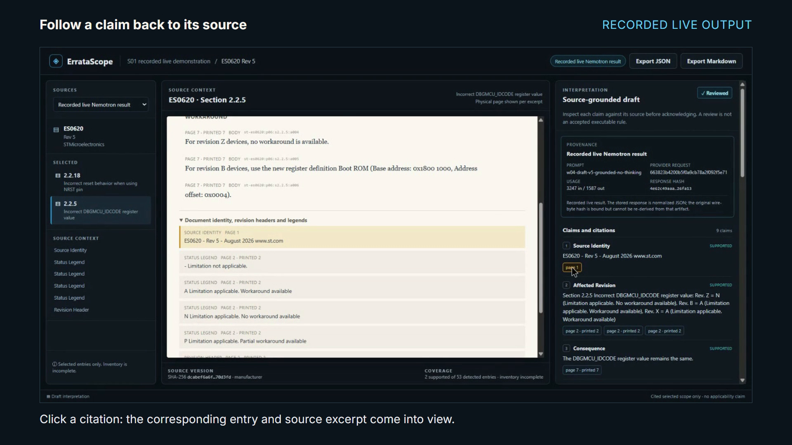
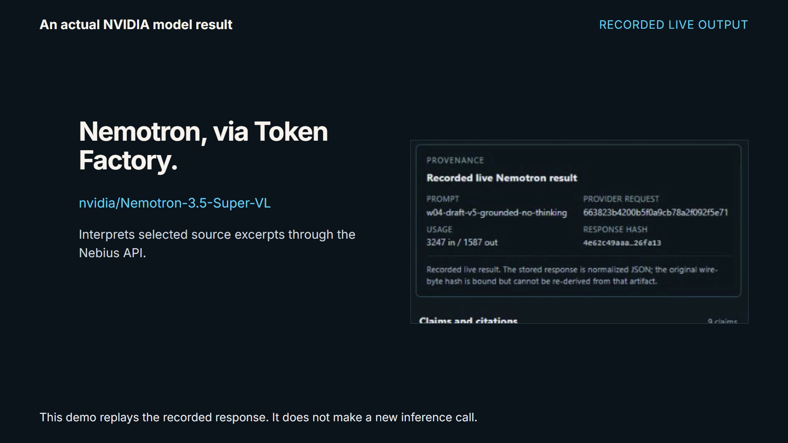
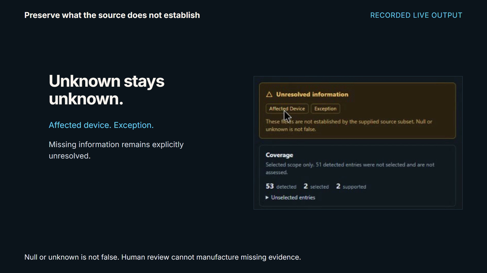
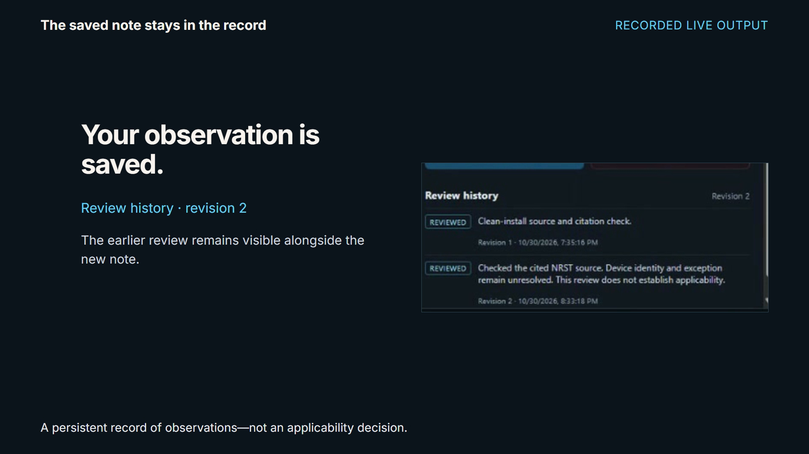
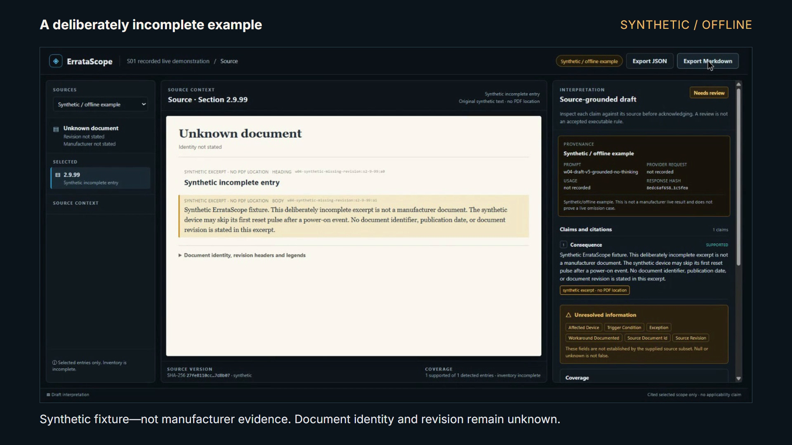

<h1 align="center">ErrataScope</h1>

<p align="center">
  <strong>Trace the claim. Keep the unknowns.</strong><br />
  Manufacturer errata, cited AI interpretations, and human review in one workspace.
</p>

<p align="center">
  Built for the <a href="https://nebiusglobalaihackathon.devpost.com/">Nebius x NVIDIA Global AI Hackathon 2026</a><br />
  Best Apps and Agents Track · By Desan Vasu
</p>

<p align="center">
  
  
  
  <a href="LICENSE"></a>
</p>

<p align="center">
  <a href="#features">Features</a> ·
  <a href="#demo">Demo</a> ·
  <a href="https://youtu.be/oD1uhOq6UHk">Watch video</a> ·
  <a href="#get-started">Get started</a> ·
  <a href="#nvidia-nemotron--nebius-token-factory">NVIDIA &amp; Nebius</a> ·
  <a href="docs/submission/release/TESTING.md">Testing guide</a>
</p>

<p align="center">
  
  <br /><sub>Actual frame from the working desktop demo · recorded live output, replayed for review.</sub>
</p>

## Why ErrataScope

A manufacturer errata sheet can change how an engineer understands a device, a reset sequence, or a workaround. An AI summary is useful when the reviewer can see its source, inspect what was selected, and recognize what the document has not established.

ErrataScope keeps the original evidence beside the interpretation. Follow a claim to its source excerpt, inspect unresolved information, record your observations, and export a reviewable record of the decision.

## Features

<table>
<tr>
<td width="50%" valign="top">

### Keep the source in view

Read selected manufacturer entries alongside the model's interpretation. Source identity, revision, SHA-256 and physical/printed page citations stay attached to the evidence.

</td>
<td width="50%" valign="top">

### Follow every displayed claim

Click a citation to switch to the corresponding entry and highlight its actual excerpt. Identity and legend context open when the cited evidence needs them.

</td>
</tr>
<tr>
<td width="50%" valign="top">

### Preserve the unknowns

Missing information remains unresolved. Selected coverage is explicit: the included real case supports two entries out of 53 detected, and the inventory remains incomplete.

</td>
<td width="50%" valign="top">

### Leave a human review

Add a required note, acknowledge or reject the interpretation, and retain the review history. Acknowledging a draft does not establish device applicability or create an accepted executable rule.

</td>
</tr>
<tr>
<td width="50%" valign="top">

### Export the evidence

Download JSON or Markdown summaries containing the source, interpretation, citations, unresolved fields, selected coverage and review history.

</td>
<td width="50%" valign="top">

### Inspect an incomplete example

Switch to a clearly labeled synthetic/offline fixture. Its missing document identity and revision stay unknown, and its excerpts are marked as having no PDF location.

</td>
</tr>
</table>

## Demo

The local test build includes **ST ES0620 Rev 5**, selected entries **2.2.18** and **2.2.5**, an actual recorded NVIDIA Nemotron result, and a separate synthetic example. **[Watch the verified 2:32 silent demo on YouTube →](https://youtu.be/oD1uhOq6UHk)** · [Video verification](videos/erratascope-demo/REVIEW.md)

1. Open **Recorded live Nemotron result** and inspect its provenance.
2. Click a claim's citation and follow the highlighted manufacturer excerpt.
3. Inspect unresolved fields and the selected coverage boundary.
4. Add a note, review or reject the interpretation, and export the summary.
5. Open **Synthetic / offline example** to inspect deliberately missing information.

<table>
<tr>
<td width="50%" valign="top">
  <a href="docs/assets/demo/provenance.png"></a>
  <p><strong>Recorded provider provenance.</strong> The demo replays an earlier actual request; opening it does not make a fresh inference call.</p>
</td>
<td width="50%" valign="top">
  <a href="docs/assets/demo/unknowns.png"></a>
  <p><strong>Uncertainty stays visible.</strong> Unknown is not false, and selected evidence is not whole-document coverage.</p>
</td>
</tr>
<tr>
<td width="50%" valign="top">
  <a href="docs/assets/demo/review-history.png"></a>
  <p><strong>A retained human decision.</strong> The new observation remains alongside the earlier review.</p>
</td>
<td width="50%" valign="top">
  <a href="docs/assets/demo/synthetic.png"></a>
  <p><strong>A separate synthetic case.</strong> This fixture is not manufacturer evidence or proof of a successful live omission test.</p>
</td>
</tr>
</table>

All screenshots are frames from the rendered application demo. [Frame provenance and attribution →](docs/assets/demo/README.md)

## Get started

### Run the free local test build

You'll need **Windows PowerShell**, **Git** (or the repository ZIP), and **Docker Desktop** running Linux containers with current Docker Compose. Tested with Compose 5.5.1. The recorded demonstration needs no host Python, Node.js, Nebius key or paid credits.

```powershell
git clone https://github.com/desanv01/ErrataScope.git
cd ErrataScope
powershell -ExecutionPolicy Bypass -File scripts/submission/start-clean.ps1
```

Open **http://127.0.0.1:18081/**. The launcher builds the app, prepares an isolated database and artifact store, downloads and verifies the pinned manufacturer PDF, imports the recorded interpretation, and prepares the original offline example. Local sign-in is prepared automatically; the developer's database is not copied.

### Supply the pinned source if needed

If ST's download is unavailable or has changed, obtain the exact **ES0620 Rev 5** PDF and supply it explicitly:

```powershell
powershell -ExecutionPolicy Bypass -File scripts/submission/start-clean.ps1 -PdfPath "C:\path\to\es0620.pdf"
```

Expected SHA-256: `dcabef6a6f7554b8ae83b9718b3924d1f76003448de3ba94b5f0a195da70d3fd`. Changed documents are refused rather than silently relabeled.

### Resume or stop

Local sessions last two hours. After the initial build, rerun the launcher with `-NoBuild` to refresh access; existing reviews and volumes are preserved.

```powershell
powershell -ExecutionPolicy Bypass -File scripts/submission/start-clean.ps1 -NoBuild
powershell -ExecutionPolicy Bypass -File scripts/submission/stop-clean.ps1
```

[Detailed setup and judging walkthrough →](docs/submission/release/TESTING.md)

## NVIDIA Nemotron & Nebius Token Factory

The backend calls **`nvidia/Nemotron-3.5-Super-VL` through the Nebius Token Factory inference API** to interpret selected manufacturer excerpts. It validates the structured response and its citation references, then preserves the resulting draft for human inspection.

Token Factory supplied hosted NVIDIA-model inference through an API, allowing the application workflow to be developed without preparing a local GPU inference server. The actual real-source request's ID, token usage, prompt version and saved response hash remain visible in the app and exports. Disabling thinking for the bounded extraction request allowed a final structured draft within its output cap.

The free test build **replays that recorded live response**. Fresh inference is disabled in this launcher and requires separately configured, authorized provider access. No provider key is shipped to the browser or repository. The synthetic/offline fixture is separate from the recorded manufacturer result.

## Built with

| Interface | API & processing | Persistence & jobs | Model runtime |
| --- | --- | --- | --- |
| React 19 · TypeScript · Vite | FastAPI · Python 3.11 · pdfplumber | PostgreSQL 17 · Valkey · RQ · private local artifacts | NVIDIA Nemotron · Nebius Token Factory |

Docker Compose provides the verified local test build. The application uses source and response hashes, append-only review history, project authorization and revision checks to keep the review record inspectable.

## Current scope

The local cited-review workflow has been independently reviewed, including an isolated clean installation. [Implementation review →](docs/submission/S01-review-01.md)

- **Included:** selected-source interpretation, citations, unknowns, explicit coverage, human reviews and JSON/Markdown export.
- **Outside this build:** applicability assessment, accepted executable rules, arbitrary PDF import, hardware simulation and automated repair. Hosted P2 and full W04/P3 remain unaccepted.
- **Evidence limitation:** the original provider wire-byte hash cannot be re-derived from its normalized saved response; the app and exports disclose that limitation.
- **Historical development data:** 41 legacy missing artifacts remain explicitly recorded. The clean test build is independent of those artifacts.

## Documentation

- [Setup and testing](docs/submission/release/TESTING.md)
- [Known limitations and attribution](docs/submission/release/KNOWN_LIMITATIONS.md)
- [Local workflow review](docs/submission/S01-review-01.md)
- [Verified video and publication steps](docs/submission/release/VIDEO_DELIVERY.md)
- [Submission description and tool feedback](docs/submission/release/SUBMISSION_COPY.md)

## Feedback

Found a problem or have a useful workflow in mind? [Open an issue](https://github.com/desanv01/ErrataScope/issues) with the expected result and reproducible steps. Use synthetic or permission-cleared examples and keep credentials and private documents out of public reports.

## License

Original ErrataScope code is [MIT licensed](LICENSE). Manufacturer documents, trademarks, model outputs and dependencies retain their own rights and licenses; see [NOTICE.md](NOTICE.md). The full vendor PDF, credentials and raw provider responses are not redistributed in this repository.
